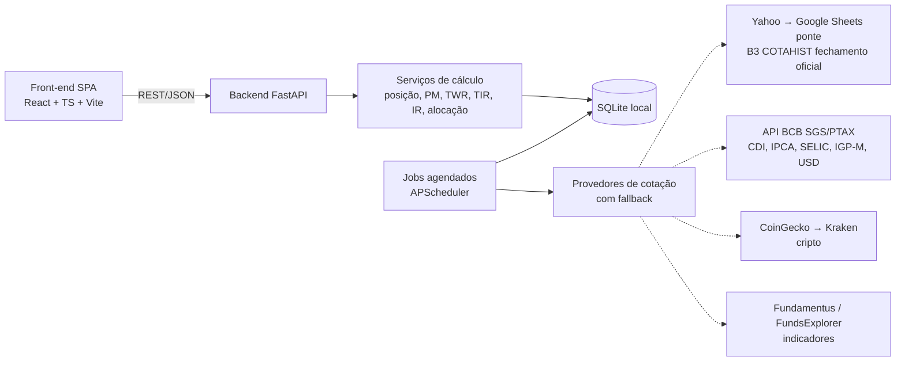
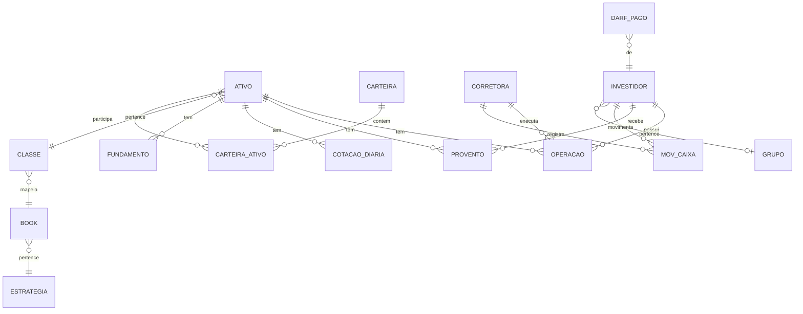

# Plano de Desenvolvimento — ControleInv (Aplicação Web de Controle de Investimentos)

> Base de análise: `Ref/Cris v7.0 DLP Gestão de Investimentos (Gratuita).xlsx` e a exportação HTML em `Ref/HTML/` (47 abas).
> Objetivo: substituir a planilha do Google Sheets por uma aplicação web com as mesmas funcionalidades, sem depender de fórmulas `QUERY`/`IMPORTXML`/Apps Script.

---

## 1. Diagnóstico da planilha

A própria planilha documenta sua arquitetura na aba `aquitetura.` em três camadas — e o app vai seguir a mesma divisão:

| Camada da planilha | Abas | Destino no app |
|---|---|---|
| **Apresentação** (visíveis) | portfólio, summary, dashboard, yields, op.normal, op.daytrade, proventos, extratos, caixa, alocação, radar, status, darf, dirpf, apuração IR, historico.consolidado, Valuation, TIR_Ativo, Cotações | **Páginas** do front-end |
| **Negócio** (ocultas com `.`) | portfolio., dashboard., summary., yields., alocacao., carteiras., books., filtros., radar., status. | **Serviços/cálculos** no backend (viram endpoints) |
| **Persistência** (ocultas com `.`) | dados., ativos., historico., index., parametros., fundamentus., fundsexplorer., darfs. | **Tabelas** no banco + **jobs** de atualização |
| **Configuração** | config.totais, config.books, config.carteiras, config.ativos, config.parâmetros | **Tela única de Configurações** (abas internas/modal), não páginas de navegação |

### 1.1 Observações importantes
- Muitas abas de negócio existem só para contornar limitações da planilha (montar SQL dinâmico via `QUERY`, colunas `Col67`, ordenação, filtros, flags `on/off`). **No app isso desaparece** — vira parâmetro de API (`?ordem=lucro_dia&dir=desc&classe=FII`).
- Existem abas duplicadas/rascunho: `Cópia de DARF` (versão antiga de `darf`), `Página117` (lançamentos de **aluguel de ações/BTC** colados do extrato), `Histórico de rendimentos` (41 MB, painel externo de proventos — mesmo conteúdo que `historico.consolidado`).
- `TIR_Ativo` depende de Apps Script (`recalcularTIR()`); `Cotações` (cripto via Kraken) também — no app vira serviço nativo.
- `leiame` é crédito/licença da DLP Invest — **não reproduzir marca, textos nem layout proprietário**; o app reimplementa as regras de negócio (públicas: regras da RFB, fórmulas financeiras) com código e identidade próprios.
- Recursos "plano PREMIUM/ULTIMATE", "sincronizar com webapp" e "e-mail diário" são do produto original — **fora do escopo inicial**.
- **Multi-investidor faz parte do escopo desde a Fase 0** (ver §4.1).

---

## 2. Mapeamento aba → funcionalidade do app

### 2.1 Páginas (menu principal)

| # | Página | Abas de origem | Conteúdo |
|---|---|---|---|
| P1 | **Resumo (Home)** | summary, summary. | Patrimônio por book/estratégia, lucro aberto, lucro do dia, TIR; IBOV/IFIX últimos 10 dias; maiores lucros/prejuízos do dia; proventos 12m; movimentação de caixa (aportes, saques, saldo); USD/EUR/BTC/ETH; SELIC/IGP-M/IPCA/CDI |
| P2 | **Portfólio** | portfólio, portfolio. | Cards de patrimônio (RV, RF, sem configuração); tabela de posições: nome pregão, peso %, corretora, posição, PM (PM ajustado por proventos), cotação, valor Graham, investido, mercado, lucro dia, lucro aberto, proventos + YoC, TIR a.m./a.a., subsetor, sparkline 180 dias; ordenações (alfabética, lucro dia, lucro aberto, proventos, YoC, investido, mercado, upside, TIR, subsetor, ranking); gráficos de exposição por ativo/subsetor/classe; agrupamento por book/carteira/classe/corretora |
| P3 | **Dashboard / Rentabilidade** | dashboard, dashboard., index. | Série mensal: fluxo de caixa, investido, mercado, lucro, TWR mês e acumulado; comparação com IBOV, IFIX, CDI, IPCA; filtros por período, ativo, classe, corretora |
| P4 | **Proventos** | proventos, yields, yields., historico.consolidado, Histórico de rendimentos | CRUD de proventos; matriz ativo × mês (12 meses), média mensal, yield 12m; histórico anual comparativo (ano × mês), totais, média/mês, acumulado; dividendos por tipo de ativo e Brasil × EUA |
| P5 | **Operações** | op.normal, op.daytrade, extratos | CRUD de operações (C/V, DT, desdobramento, grupamento, bonificação, subscrição, amortização); colunas calculadas (volume, lucro, lucro %, fluxo de caixa, qtd/PM acumulado); importação de extrato |
| P6 | **Caixa** | caixa | Movimentações por corretora (aporte, saque, crédito/débito, proventos, day trade), saldo e conversão cambial |
| P7 | **Alocação & Rebalanceamento** | alocação, alocacao., carteiras. | Exposição por subsetor; alocação ideal × atual; balanceamento entre carteiras; simulador de aporte (só comprar / só vender / manter ativo acima do teto / só com indicação aberta); destaque de ajustes acima de X% |
| P8 | **Radar / Watchlist** | radar, radar., fundamentus., fundsexplorer. | Acompanhamento de ativos (com ou sem posição): cotação, Graham, preço-teto/upside, drawdown 60 dias, YoC, mín/máx 52 semanas, variação 1/7/14 dias, indicadores (P/VP, ROE, DY, P/L…) |
| P9 | **Status do ativo** | status, status. | Drill-down de um ativo/carteira/book: investido, mercado, lucro aberto, proventos 12m, YoC, swing/day trades, distribuição do lucro, linha do tempo de operações e eventos |
| P10 | **Imposto de Renda** | apuração IR, darf, darfs., Cópia de DARF, dirpf | Apuração mensal por categoria, prejuízo a compensar, DARF a pagar (código 6015), registro de DARFs pagos; relatório DIRPF (bens e direitos, isentos, tributação exclusiva) |
| P11 | **Valuation** | Valuation, TIR_Ativo | Calculadora por ticker: Graham, Bazin, DCF, Gordon, P/L justo etc. (7 modelos) + análise final; TIR/TWR de um ativo específico |
| P12 | **Aluguel de ações (BTC)** | Página117 | Lançamentos de BTC (remuneração bruta, taxa, IRRF, líquido) por ticker — opcionalmente integrado a Proventos |
| P13 | **Cripto** | Cotações, darf (coluna CRIPTOMOEDA) | Página própria: cotações em USD e BRL, variação 24h/7d/30d, market cap, gráfico de preço; posição em cripto (qtd, PM, investido, mercado, lucro); controle mensal do limite de isenção de R$ 35 mil em vendas e ganho tributável |

### 2.2 Configurações (sem página no menu — tela/modal "⚙ Configurações")

| Seção | Aba de origem | O que configura |
|---|---|---|
| Estratégias & Books | config.totais, books. | Peso RV × RF (ex.: 30/70), peso de cada book na estratégia, mapeamento **classe → book** (AÇÃO, BDR → Ações; FII → Fundos Imobiliários; STOCK/REIT/ETF_US → Invest Exterior…) |
| Books por ativo | config.books | Exceções: % de um ativo distribuído entre books |
| Carteiras | config.carteiras, carteiras. | Até N carteiras (nome, categoria: Conservador/Arrojado/Renda Passiva), ativos, preço-teto, peso %, ranking, "entra no cálculo do preço-teto?" |
| Ativos personalizados | config.ativos | Ativos sem cotação automática (poupança, CDB, previdência) e ativos de renda fixa com cálculo automático (índice + % do índice + taxa a.a.) |
| Investidores | config.parâmetros (Multi Investidor) | Cadastro de investidores (nome, CPF, grupo/família), investidor padrão; corretoras vinculadas a cada investidor |
| Parâmetros | config.parâmetros, parametros. | Moeda base, dias de liquidação PTAX, somar caixa no portfólio, regras de DARF (somar day trade/opções/outras classes no limite de 20k, subscrição FII, BDR como ação), ano-base DIRPF, prejuízo transportado de exercício anterior |
| Cadastro de ativos | ativos. | Ticker, classe, setor, subsetor, nome pregão, moeda, origem da cotação (geralmente automático) |

### 2.3 Descartado / absorvido
`leiame`, `aquitetura.`, `filtros.` (vira query params), `Cópia de DARF` (substituída por P10), `Histórico de rendimentos` (absorvido em P4), flags `on/off` e colunas `ColNN`.

---

## 3. Arquitetura proposta

| Camada | Tecnologia sugerida | Justificativa |
|---|---|---|
| Backend | Python 3.12+ · FastAPI · SQLAlchemy 2 · Alembic · Pydantic | Python já usado no ambiente; ótimo para cálculos financeiros (pandas/numpy) |
| Banco | SQLite (arquivo local) | Roda em um computador; volume pequeno (~2 mil operações, ~3,4 mil proventos). ORM permite migrar para PostgreSQL depois |
| Cálculos | pandas, numpy, `scipy.optimize` (XIRR) | TWR, TIR, séries mensais |
| Jobs | APScheduler | Atualização de cotações/índices/fundamentos |
| Front-end | React + TypeScript + Vite · TanStack Query/Table · ECharts ou Recharts · Tailwind | Tabelas ricas com ordenação/filtro, gráficos e sparklines |
| Testes | pytest (backend) · Vitest (front) | Golden tests comparando com valores da planilha |
| Execução local | FastAPI serve o build do React (`frontend/dist`) em `http://127.0.0.1:8000`; script `iniciar.bat` sobe tudo | Um único processo, sem Docker; escuta só em `127.0.0.1` |
| Empacotamento (futuro) | pywebview + PyInstaller (janela desktop) | Opcional, quando estabilizar |

---

## 4. Modelo de dados (núcleo)

| Tabela | Campos principais | Origem |
|---|---|---|
| `investidor` | nome, apelido, cpf, grupo_id, cor, ativo | config.parâmetros (Multi Investidor) |
| `grupo` | nome (ex.: "Família") | config.parâmetros |
| `corretora` | nome, cnpj (para DIRPF) | op.normal, caixa |
| `ativo` | ticker, market_cod, nome_pregao, classe, setor, subsetor, moeda, origem_cotacao, ativo_personalizado | ativos., config.ativos |
| `operacao` | **investidor**, ativo, data, evento (C, V, DT, DESD, GRUP, BONIF, SUBS, AMORT…), qtd, preco, taxas, irrf, corretora, moeda, observacao, tipo (normal/daytrade), arquivo_origem | op.normal, op.daytrade, extratos |
| `provento` | **investidor**, ativo, data_pagto, data_com, evento (DIVIDENDO, JCP, RENDIMENTO, AMORTIZAÇÃO, BTC…), valor, irrf, taxas, moeda, ptax, corretora | proventos, Página117 |
| `mov_caixa` | **investidor**, data, evento, valor, moeda, corretora, observacao | caixa |
| `cotacao_diaria` | ativo, data, preco, variacao, fonte | historico., ativos. |
| `cotacao_cripto` | simbolo, data_hora, preco_usd, preco_brl, var_24h, market_cap, fonte | Cotações |
| `indice_mensal` | data, ibov, ifix, cdi, ipca, selic, igpm, usd, eur | index., parametros. |
| `fundamento` | ativo, data_ref, P/L, P/VP, DY, ROE, ROIC, margens, liquidez… (FII: DY 3/6/12m, PL, liquidez) | fundamentus., fundsexplorer. |
| `estrategia`, `book`, `classe_book` | nome, peso, ordem, ativo | config.totais, books. |
| `ativo_book` | ativo, book, percentual | config.books |
| `carteira`, `carteira_ativo` | nome, categoria, ativa; ativo, preco_teto, peso, ranking, entra_preco_teto | config.carteiras, carteiras. |
| `parametro` | chave, valor | config.parâmetros, parametros. |
| `darf_pago` | investidor, competencia, data_pagamento, valor | darfs. |
| `prejuizo_inicial` | **investidor**, categoria (normal, DT, FII, cripto), valor, ano | config.parâmetros |
| `valuation_premissa` | ticker, LPA, VPA, div_anual, WACC, g, payout, P/L hist./setor, ROE | Valuation |

> `dados.`, `historico.`, `portfolio.`, `dashboard.` etc. **não viram tabelas**: são resultados calculados. `historico.` (posição mensal por ativo **e investidor**) pode virar uma **tabela materializada** `snapshot_mensal` recalculada por job, para performance do dashboard.

### 4.1 Multi-investidor

- **Seletor global** no cabeçalho: um investidor, vários, um grupo (ex.: Família) ou "Todos". A seleção vira parâmetro `investidores=1,2` em todos os endpoints e fica salva no navegador.
- **Posição e PM são calculados por investidor + ativo** (o mesmo ticker em CPFs diferentes tem PMs diferentes). Na visão consolidada, soma posições e recalcula PM ponderado.
- **IR é sempre por CPF**: apuração, limite de isenção de R$ 20 mil/R$ 35 mil, prejuízo acumulado, DARF e DIRPF nunca são consolidados. Na página de IR o seletor exige um único investidor.
- **Configurações compartilhadas**: estratégias, books, carteiras e cadastro de ativos são comuns a todos; pesos-alvo podem ter sobrescrita por investidor (evolução).
- Rodando local em um computador, **não há login**: investidor é filtro, não usuário. Se no futuro for para a rede, adicionar autenticação e vínculo usuário ↔ investidores.
- CPF armazenado mascarado na interface (`***.456.789-**`) e usado só em relatórios de IR.

---

## 5. Regras de negócio a implementar (serviços)

| Serviço | Regra | Validar contra |
|---|---|---|
| **Posição & PM** | Qtd acumulada; PM ponderado com taxas; venda não altera PM; zera ao encerrar; eventos societários (desdobramento, grupamento, bonificação com custo, subscrição); **PM ajustado** = PM − proventos/qtd | dados., coluna `qtd_atual`/PM de op.normal |
| **Lucro de trades** | Lucro na venda = (preço venda − PM) × qtd − taxas; separado swing × day trade | op.normal `lucro`, op.daytrade |
| **Moeda/FX** | Conversão USD→BRL por PTAX (D-2 configurável), `pm_fx`, `fator_fx` | dados. `pm_fx`, ativos. `fator_fx` |
| **Valor de mercado & lucro** | mercado = qtd × cotação × fx; lucro aberto; lucro do dia; peso % no portfólio e no book | portfólio |
| **TIR (XIRR)** | Por ativo, book e total; a.m. e a.a., fluxos = operações + proventos + valor de mercado final | portfólio "TIR % am % aa", TIR_Ativo |
| **TWR** | Mensal e acumulado: (mercado_fim − mercado_ini − fluxo) / (mercado_ini + fluxo) | dashboard. `TWR % a.m`, `TWR_acc` |
| **YoC / Yield** | YoC = proventos 12m / investido; DPA; yield sobre mercado | portfólio, yields |
| **Graham** | √(22,5 × LPA × VPA) | portfólio "valor graham", Valuation |
| **Bazin / DCF / outros** | Bazin = dividendo anual / 6%; DCF com WACC, g inicial, g perpétuo, anos; g = ROE × (1 − payout) | Valuation |
| **Preço-teto & upside** | Por carteira; upside = teto / cotação − 1 | carteiras., radar |
| **Drawdown** | Queda máxima na janela (padrão 60 dias), mín/máx 52 semanas, variações 1/7/14 dias | radar. |
| **Alocação/Rebalanceamento** | Peso alvo (estratégia × book × carteira × ativo) vs atual; ajuste com aporte; modos só comprar/só vender/manter acima do teto | alocacao., alocação |
| **Apuração IR (RV)** | Ações swing 15% com **isenção vendas ≤ R$ 20 mil/mês**; day trade 20% (IRRF 1%); swing IRRF 0,005%; FII/Fiagro 20% sem isenção; ETF 15% sem isenção; BDR 15% (configurável como ação); opções 15%; compensação de prejuízo **por categoria** (normal × DT; FII separado); DARF mínimo R$ 10 acumulável; abatimento de IRRF | darf, apuração IR, Cópia de DARF |
| **Exterior / Cripto** | Exterior: regras da Lei 14.754/2023 (apuração anual 15%); cripto: isenção alienação ≤ R$ 35 mil/mês | darf (colunas INTERNACIONAL/CRIPTOMOEDA) |
| **DIRPF** | Bens e direitos (posição 31/12 a custo), rendimentos isentos (dividendos, FII), tributação exclusiva (JCP), por CNPJ/corretora | dirpf |
| **BTC (aluguel)** | Remuneração bruta − taxa − IRRF = líquido; classificar como renda tributável | Página117 |
| **Renda fixa automática** | Ativos com índice (CDI/SELIC/IPCA/Poupança) × % + taxa a.a. → valor atualizado diário | config.ativos |

> **Atenção:** as alíquotas e limites de IR devem ficar **parametrizados em tabela** (vigência início/fim), pois mudam por legislação. Validar sempre com contador/RFB antes de usar para recolhimento real.

---

## 6. Integrações externas

### 6.1 Google Finance — dá para usar?

A planilha usa a função `GOOGLEFINANCE()`, que **só existe dentro do Google Sheets**. O Google Finance **não tem API pública** (a antiga foi desligada em 2011). Opções:

| Forma | Funciona? | Problemas |
|---|---|---|
| Raspar `google.com/finance` | Funciona, mas frágil | Viola os termos de uso, HTML muda sem aviso, risco de bloqueio por IP |
| **Planilha-ponte** no Google Sheets com `GOOGLEFINANCE()` lida pelo app | Sim, é a forma legítima e **gratuita** | Atraso de até 20 min; FII e alguns BDRs às vezes retornam `#N/A`; sem proventos nem fundamentos |

**Conclusão:** a planilha-ponte é a **segunda fonte** (fallback) — gratuita, oficial e lê todos os tickers numa única chamada.

**Como funciona a planilha-ponte:**
1. Planilha separada `ControleInv-Cotacoes` com coluna A = tickers (o app escreve a lista) e colunas B.. = `GOOGLEFINANCE(A2;"price")`, `"changepct"`, `"high52"`, `"low52"` etc.
2. O app lê o intervalo via **API do Google Sheets** (conta de serviço, JSON fora do Git) em uma única requisição. Cota gratuita: 300 leituras/min.
3. A planilha contém **só tickers e preços** — nenhuma posição, valor ou CPF.

### 6.2 Por que não brapi.dev

O plano gratuito da brapi é só para teste: 1 ativo por requisição, 15 mil requisições/mês, atualização a cada 30 min, histórico de 3 meses, **sem dividendos, sem cripto, sem PTAX/índices e sem fundamentos**. Com ~100 ativos atualizando a cada 30 min no pregão (≈ 35 mil req/mês) o limite estoura. Os planos pagos começam em ~R$ 100/mês. Fica **fora** do plano; a interface `ProvedorCotacao` permite plugá-la depois, se decidir assinar.

### 6.3 Fontes recomendadas (todas gratuitas)

| Dado | Fonte principal | Fallback | Frequência |
|---|---|---|---|
| Cotações B3 (ações, FII, ETF, BDR) | **Yahoo Finance** (`yfinance`, sufixo `.SA`, vários tickers por chamada) | Google Sheets ponte | 15 min no pregão |
| Cotações EUA (STOCK, REIT, ETF_US) | **Yahoo Finance** | Google Sheets ponte | 15 min / diário |
| Fechamento oficial e histórico B3 | **B3 COTAHIST** (arquivo oficial diário/anual, gratuito, todos os papéis) | Yahoo | Diário (após 20h) + carga histórica inicial |
| Histórico (sparkline 180d, drawdown, 52 semanas) | Base local (`cotacao_diaria`, alimentada por COTAHIST/Yahoo) | — | Diário |
| Desdobramentos/grupamentos (alerta) | Yahoo (`splits`) | Lançamento manual | Diário |
| Cripto | **CoinGecko** (chave Demo gratuita; várias moedas por chamada; USD e BRL; market cap; histórico) | Kraken API pública (já usada na aba Cotações) | 5–15 min |

- Cada fonte implementa a mesma interface `ProvedorCotacao` (`cotacao_atual`, `historico`); a ordem de prioridade fica em Configurações e o app tenta a próxima quando uma falha.
- Cada cotação grava a `fonte` e o horário, exibidos na interface ("Yahoo · 14:32").
- `yfinance` não é API oficial do Yahoo e pode mudar — por isso a planilha-ponte e o COTAHIST existem como redes de segurança.
- Proventos **não dependem de API**: vêm do lançamento manual e da importação do extrato da B3 (Área do Investidor), como na planilha atual.

| Dado | Fonte | Frequência |
|---|---|---|
| CDI, SELIC, IPCA, IGP-M | API SGS do Banco Central (séries 12, 432, 433, 189) | Diário/mensal |
| PTAX USD/EUR | API Olinda PTAX do BCB | Diário |
| IBOV / IFIX | Yahoo (`^BVSP`) → Google Sheets ponte (`INDEXBVMF:IBOV`, `INDEXBVMF:IFIX`) | Diário |
| Fundamentos ações | Fundamentus (scraping da página de resultados, respeitando termos de uso) | Semanal |
| Fundamentos FII | FundsExplorer / Status Invest (scraping, respeitar termos) | Semanal |

Requisitos: cache local, retry com backoff, timeout, log de falhas, nunca bloquear a UI esperando fonte externa, tokens em variável de ambiente (`.env`, fora do Git).

---

## 7. Migração dos dados da planilha

1. **Script `importar_planilha.py`** lendo o `.xlsx` (openpyxl/pandas):
   - `op.normal` (≈2,2 mil linhas) e `op.daytrade` → `operacao`
   - `proventos` (≈3,4 mil linhas) + `Página117` → `provento`
   - `caixa` → `mov_caixa`
   - `ativos.` → `ativo` (classe/setor/subsetor)
   - `config.*` → tabelas de configuração
   - `index.` → `indice_mensal`
   - `darfs.` → `darf_pago`
2. Normalizar datas (`dd/mm/aaaa` e `aaaa-mm-dd`), números pt-BR (`1.234,56`), tickers alterados (BIDI4→INTR, BRDT3→VBBR3, MRFG3→MBRF3, VVAR3→BHIA3, LAME4…) — criar tabela `ticker_alias`.
3. **Conciliação automática** pós-importação: comparar posição, PM, investido, mercado, proventos e lucro por ativo com `dados.` e `portfolio.`; gerar relatório de divergências.
4. Importação **idempotente** (hash por linha) para permitir reimportar enquanto a planilha ainda é usada em paralelo.

---

## 8. Roadmap por fases

### Fase 0 — Fundação ✅
- [x] Estrutura `backend/` e `frontend/`, `.gitignore`, `.env.example`, `iniciar.bat` e `dev.bat` (lint/pre-commit pendentes)
- [x] Modelagem SQLAlchemy + Alembic (tabelas do §4, já com `investidor`, `cambio` e `cotacao_moeda`)
- [x] Script de importação da planilha (§7) + relatório de conciliação — 51/52 posições idênticas; INTR difere por inconsistência da planilha na troca INBR31→INTR (o app preserva o custo total)
- [x] Layout base React: menu lateral, seletor global de investidor, rota de Configurações
- [x] Interface `ProvedorCotacao` + provedor Yahoo (cotações e câmbio)

### Fase 1 — MVP de carteira (núcleo) ✅
- [x] CRUD de investidores, ativos (API + cadastro rápido no formulário), operações, proventos e caixa (API + formulários de lançamento/edição/exclusão)
- [x] Serviço de posição/PM/lucro de trades por investidor (com eventos societários e câmbio) + visão consolidada
- [x] Job de cotações (APScheduler: Yahoo a cada 15 min no pregão) + PTAX oficial do BCB (câmbio atual e autopreenchimento nos lançamentos: PTAX venda da data do fato gerador, Lei 14.754/2023 art. 15) — **planilha-ponte Google Sheets adiada** (decisão do usuário)
- [x] Carga histórica B3 COTAHIST (desde a 1ª operação, 2017) + job diário (21h e 8h, recupera dias perdidos ao iniciar); fechamento oficial prevalece sobre o Yahoo no mesmo dia
- [x] **P2 Portfólio** (tabela ordenável, cards, agrupamento por classe/setor com subtotais e gráficos de exposição por classe, setor e ativo)
- [x] **P5 Operações**, **P4 Proventos** e **Caixa** (listagem com filtros e formulários de lançamento)
- [x] Golden tests: posição e PM batem com `dados.` para todos os ativos abertos (conciliação no importador)
- [x] Tela "Status das atualizações" (Configurações → Atualizações)
- **Entrega:** substitui portfólio + lançamentos da planilha

### Fase 2 — Rentabilidade e resumo ✅
- [x] Job de índices (CDI 4391, SELIC 4390, IPCA 433, IGP-M 189 do SGS; IBOV/IFIX da API de índices da B3) + PTAX diária (SGS 1/21620) + histórico de ativos do exterior (Yahoo, com reversão do ajuste de desdobramentos). Tarefas `indices_diario` (9h e 20h) e `historico_complementar` (carga completa)
- [x] Série mensal calculada sob demanda (sem `snapshot_mensal`: ~0,2 s para 10 anos / 100 ativos; usa só o último preço de cada mês)
- [x] TWR (fórmula da aba `dashboard.`), TIR (XIRR próprio, sem scipy) total e por posição, YoC 12m
- [x] **P3 Dashboard** (TWR acumulado × IBOV/IFIX/CDI/IPCA, evolução patrimonial, resultado mensal, mapa de calor ano × mês)
- [x] **P1 Resumo** (home): patrimônio, lucro, TIR, janelas Mês/Ano/12m/início × referências, proventos 12m, altas/baixas do dia
- [x] Matriz de proventos (ano × mês e ativo × mês) — completa P4
- [x] Conciliação (`scripts/conciliar_rentabilidade.py`): investido, mercado, proventos, trades e TWR mensal **idênticos** de 2018 a 2026 (106/114 meses; TWR jan/2018–jul/2026: planilha 86,82% × app 86,75%). Os 8 meses divergentes (2017) vêm de preço errado de FAED11 na planilha (R$ 96 × R$ 208 oficial da B3). Diferença constante de R$ 97,61 no investido desde jul/2022 = inconsistência INBR31→INTR já registrada
- [ ] TIR total × planilha: **não conciliável** — a TIR da aba `portfolio.` é valor estático gravado pelo Apps Script `recalcularTIR()`, de data desconhecida (XIRR validado por testes unitários)
- COTAHIST passa a aceitar o código antigo `XXXX11B` dos FIIs (B3 removeu o sufixo em 2017)

### Fase 3 — Configurações e alocação ✅
- [x] **Tela de Configurações**: estratégias e books (pesos, classe → book, exceções por ativo), carteiras (categoria, peso-alvo no book, preço-teto, ranking; um ativo por carteira), ativos personalizados e parâmetros. Migração carrega os padrões da aba `config.totais` (RV 30% / RF 70%, 13 books, ~65 classes) — carteiras, exceções e ativos personalizados estavam vazios na planilha
- [x] Ativos personalizados: renda fixa automática (cota = 1 na data-base × índice mensal CDI/SELIC/IPCA/IGP-M pró-rata × % do índice + taxa a.a.; mês sem índice repete o último) recalculada nas tarefas de cotações e índices; saldo manual (cota = saldo ÷ quantidade). Formulário de operação sugere a cota da data como preço
- [x] Agrupamento do portfólio por estratégia, book e carteira (+ exposição por book). Ativo com exceção aparece no book de maior percentual; a alocação usa a distribuição completa
- [x] **P7 Alocação & Rebalanceamento**: alvo × atual por estratégia, book e ativo; simulador de aporte (só comprar / rebalancear, respeitar preço-teto), restante do book dividido igualmente entre ativos sem peso definido
- [x] **P6 Caixa** com saldo por corretora e moeda; integra compras, vendas, amortizações e proventos a partir da data configurada (parâmetro) e pode somar ao patrimônio do Portfólio

### Fase 4 — Imposto de renda
- [ ] Tabela de regras fiscais com vigência
- [ ] Apuração mensal por categoria + compensação de prejuízo + IRRF
- [ ] **P10 IR**: apuração, DARF a pagar, registro de DARFs pagos
- [ ] Relatório DIRPF (bens e direitos, isentos, exclusivos) com exportação PDF/CSV
- [ ] Golden tests contra `darf`/`apuração IR`/`Cópia de DARF` (2017–2026)

### Fase 5 — Análise
- [ ] Job de fundamentos (ações e FII)
- [ ] **P8 Radar/Watchlist** (drawdown, variações, 52 semanas, indicadores)
- [ ] **P9 Status do ativo** (drill-down + linha do tempo)
- [ ] **P11 Valuation** (7 modelos) e TIR/TWR por ativo
- [ ] Provedor CoinGecko → Kraken + **P13 Cripto** (página própria, com controle de isenção R$ 35 mil/mês)

### Fase 6 — Importação e qualidade de vida
- [ ] **Importação de extratos** (B3 Área do Investidor — movimentação/negociação em XLSX; notas de corretagem PDF como evolução) — substitui `extratos`
- [ ] **P12 Aluguel (BTC)** a partir do extrato B3
- [ ] Exportação CSV/XLSX de qualquer tabela
- [ ] Backup/restauração do banco
- [ ] (Opcional) autenticação (se sair do computador local), relatório diário por e-mail, PWA/mobile

---

## 9. Decisões

| # | Decisão | Status | Escolha |
|---|---|---|---|
| D1 | Onde roda | ✅ Decidido | Local, em um computador (`127.0.0.1`), SQLite |
| D2 | Formato | ✅ Decidido | React + TypeScript (Vite) com backend FastAPI |
| D3 | Usuários | ✅ Decidido | Vários investidores (§4.1), sem login |
| D4 | Fonte de cotações | ✅ Decidido | Gratuitas: Yahoo → Google Sheets ponte (GOOGLEFINANCE) + B3 COTAHIST; cripto CoinGecko → Kraken; brapi descartada (§6) |
| D5 | Página Cripto | ✅ Decidido | Página própria (P13) |
| D6 | BTC (Página117) | Pendente | Sugestão: tipo de provento + filtro |
| D7 | Planilha em paralelo | Pendente | Sugestão: reimportação idempotente até estabilizar |

---

## 10. Requisitos não funcionais

- **Segurança:** dados locais; se exposto em rede, autenticação + HTTPS; segredos em `.env`; validação de entrada (Pydantic); sem SQL dinâmico concatenado (ORM/parametrizado); uploads de extrato com limite de tamanho e validação de tipo.
- **Precisão:** `Decimal` para valores monetários (não `float`); arredondamento explícito; fuso `America/Sao_Paulo`.
- **Performance:** portfólio < 1 s com ~100 ativos e ~10 anos de histórico; snapshots mensais materializados; cotações em cache.
- **Formatação pt-BR:** `R$ 1.234,56`, datas `dd/mm/aaaa`, meses `jan./2026`.
- **Testabilidade:** serviços de cálculo puros (sem I/O), cobertos por golden tests derivados da planilha.
- **Observabilidade:** log estruturado de jobs (início, fim, falhas por fonte) e tela "Status das atualizações".

---

## 11. Critérios de aceite da migração

1. Posição, PM, investido e mercado por ativo **iguais** à planilha (tolerância R$ 0,01 por ativo).
2. Proventos por mês/ano **iguais** a `historico.consolidado`.
3. TWR mensal e TIR total com diferença ≤ 0,05 p.p. em relação a `dashboard.`/`portfolio.`.
4. DARF mensal 2017–2026 igual a `darf`/`apuração IR` (ou divergência explicada por correção de regra).
5. Todas as páginas do §2.1 funcionais; configurações do §2.2 acessíveis sem página própria no menu.
