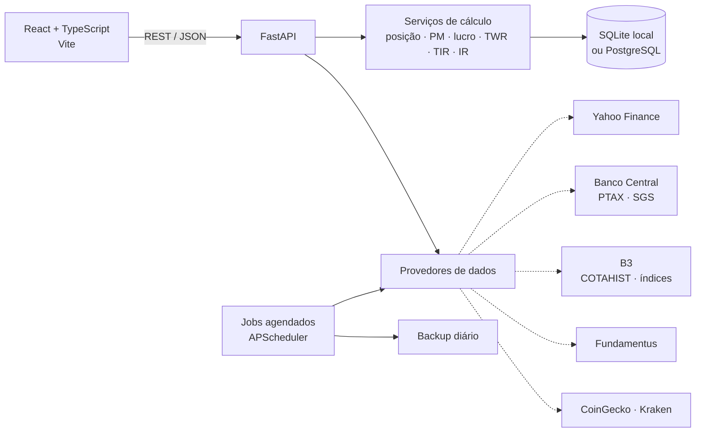

<div align="center">

# InvestHub+

**Controle de investimentos pessoal e multi-investidor — carteira, proventos, rentabilidade e imposto de renda, rodando localmente no seu computador.**


[Primeiros passos](#primeiros-passos) ·
[Como usar](#como-usar) ·
[Funcionalidades](#funcionalidades) ·
[Regras de cálculo](#regras-de-cálculo) ·
[API](#api) ·
[Changelog](CHANGELOG.md)

</div>

---

## Apresentação

O **InvestHub+** é uma aplicação web **local** que substitui planilhas de controle de investimentos (Google Sheets/Excel). Ela reúne, em um só lugar, as operações, proventos, caixa e cotações de **um ou vários investidores** (família, cônjuge, filhos) e entrega, sem fórmulas manuais:

- **posição e preço médio** calculados conforme as regras da Receita Federal, inclusive em moeda estrangeira (PTAX);
- **rentabilidade** real da carteira (TWR e TIR) comparada a IBOV, IFIX, CDI e IPCA;
- **alocação-alvo** por estratégia, book e ativo, com simulador de aporte;
- **apuração mensal de IR**, DARF 6015 e relatório de apoio à **DIRPF**;
- ferramentas de análise: **Radar**, **Status do ativo**, **Valuation** e **Cripto**.

Tudo roda em `127.0.0.1`: os dados ficam no seu computador, e as únicas chamadas externas são consultas públicas de cotações e índices.

### Por que usar

| Na planilha | No InvestHub+ |
|---|---|
| Fórmulas frágeis, quebram ao inserir linhas | Regras de negócio testadas automaticamente |
| Cotação via `GOOGLEFINANCE`, sem histórico confiável | Yahoo Finance no pregão + fechamento oficial da B3 (COTAHIST) + PTAX/índices do Banco Central |
| Um arquivo por investidor | Multi-investidor com grupos e visão consolidada |
| Digitação manual do extrato | Importação dos relatórios da B3 e do extrato de aluguel, com detecção de duplicidade |
| IR calculado "na mão" | Apuração mensal por CPF, compensação de prejuízo por grupo, DARF e DIRPF |
| Backup depende de lembrar | Backup automático diário com restauração validada |

### Destaques

- 👨‍👩‍👧 **Multi-investidor** — seletor global: um investidor, um grupo ou todos consolidados.
- 🔄 **Cotações automáticas** — atualização a cada 15 min no pregão, fechamento oficial e histórico diário desde a primeira operação.
- 📈 **Rentabilidade de verdade** — TWR mensal, TIR/XIRR, evolução patrimonial e mapa de calor.
- 🧾 **IR completo** — Brasil (ações, BDR, ETF, opções, day trade, FII) e exterior (Lei 14.754/2023).
- 📥 **Importação** — planilha original (idempotente) e relatórios da Área do Investidor da B3.
- 📤 **Exportação** — CSV e XLSX de qualquer tela, com tipos (moeda, %, data) preservados.
- 🔒 **Privado** — local, sem conta, sem nuvem obrigatória; CPF sempre mascarado.

---

## Sumário

- [Apresentação](#apresentação)
- [Primeiros passos](#primeiros-passos)
- [Como usar](#como-usar)
- [Telas da aplicação](#telas-da-aplicação)
- [Funcionalidades](#funcionalidades)
- [Arquitetura](#arquitetura)
- [Tecnologias](#tecnologias)
- [Requisitos](#requisitos)
- [Instalação e execução](#instalação-e-execução)
- [Banco de dados: SQLite ou PostgreSQL](#banco-de-dados-sqlite-ou-postgresql)
- [Importando a planilha](#importando-a-planilha)
- [Estrutura do projeto](#estrutura-do-projeto)
- [Regras de cálculo](#regras-de-cálculo)
- [API](#api)
- [Testes e qualidade](#testes-e-qualidade)
- [Perguntas frequentes](#perguntas-frequentes)
- [Versionamento e contribuição](#versionamento-e-contribuição)
- [Roadmap](#roadmap)
- [Privacidade e segurança](#privacidade-e-segurança)
- [Aviso legal](#aviso-legal)

---

## Primeiros passos

Pré-requisitos: **Windows**, **Python 3.12+** e **Node.js 20+** (detalhes em [Requisitos](#requisitos)).

```bat
git clone https://github.com/Cristianosm91/Controle_Investimentos.git
cd Controle_Investimentos
iniciar.bat
```

Pronto: o navegador abre em **http://127.0.0.1:8000**. Na primeira execução o `iniciar.bat` prepara tudo sozinho (ambiente Python, dependências, compilação da interface e banco de dados). Para encerrar, pressione `Ctrl+C` no terminal ou rode `parar.bat`.

> Os dados ficam em `%LOCALAPPDATA%\InvestHub\investhub.db`, fora de pastas sincronizadas. Nada precisa ser configurado para começar.

---

## Como usar

Roteiro recomendado para quem está começando. A versão e a navegação ficam no menu lateral; o **seletor de investidor** e os botões **CSV/XLSX** ficam no topo de todas as telas.

### 1. Cadastre os investidores

Em **⚙️ Configurações → Investidores**, cadastre cada pessoa (nome e CPF — exibido sempre mascarado). Se quiser ver patrimônios somados, crie um **grupo** (ex.: *Família*). O seletor no topo passa a filtrar todas as telas por investidor, grupo ou todos.

### 2. Traga o histórico

Escolha a forma que combina com você (é possível combinar as três):

| Origem | Onde | Quando usar |
|---|---|---|
| **Planilha antiga** | Linha de comando ([Importando a planilha](#importando-a-planilha)) | Migração inicial a partir da planilha de controle |
| **Extratos da B3** | Botão **Importar extrato B3** em *Operações* e *Proventos* | Relatórios *Negociação*, *Movimentação* e *Proventos recebidos* da Área do Investidor |
| **Extrato de aluguel** | Botão de importação em *Aluguel (BTC)* | Extrato da conta da corretora (`.xlsx`/`.csv`) |
| **Digitação** | *Operações*, *Proventos* e *Caixa* | Lançamentos do dia a dia |

Todas as importações mostram uma **prévia** antes de gravar e marcam linhas *Já existe* ou *Verificar* — reimportar o mesmo arquivo não duplica nada.

### 3. Carregue cotações e índices

Na primeira inicialização após importar, o app baixa sozinho o histórico da B3 (COTAHIST) e o complementar (exterior, criptos, PTAX e índices). Se algo ficar pendente, use **Configurações → Atualizações** ou o aviso **Carregar histórico de cotações** em *Rentabilidade*. Depois disso, os jobs automáticos mantêm tudo em dia.

### 4. Organize a carteira

Em **Configurações**:

- **Estratégias & Books** — defina estratégias (ex.: *Dividendos*, *Crescimento*) e books, com o peso de cada um e o mapeamento classe → book (com exceções por ativo).
- **Carteiras** — peso-alvo, preço-teto e ranking dos ativos.
- **Ativos personalizados** — renda fixa com rendimento automático (CDI, SELIC, IPCA, IGP-M, prefixado) ou saldo manual.
- **Parâmetros** e **Imposto de renda** — data de início do caixa automático, regras fiscais com vigência e prejuízo inicial.

### 5. Acompanhe no dia a dia

| Quero... | Vá em |
|---|---|
| Ver patrimônio, lucro, TIR e TWR do mês/ano | **🏠 Resumo** |
| Ver posições, PM, lucro e exposição por book/classe/setor | **💼 Portfólio** |
| Comparar com IBOV, IFIX, CDI e IPCA | **📈 Rentabilidade** |
| Acompanhar dividendos e o aluguel de ações | **💰 Proventos** · **🤝 Aluguel (BTC)** |
| Saber quanto comprar de cada ativo no próximo aporte | **⚖️ Alocação** (simulador de aporte) |
| Monitorar ativos que ainda não tenho | **📡 Radar** |
| Analisar um ativo, carteira ou book em detalhe | **🔎 Status do ativo** · **🧮 Valuation** |
| Acompanhar criptomoedas | **🪙 Cripto** |

### 6. Feche o mês do IR

Em **🧾 Imposto de Renda**, escolha o CPF e o ano: a tela mostra a apuração mês a mês, o DARF 6015 a recolher (com acúmulo abaixo de R$ 10) e permite registrar DARFs pagos. No início do ano, use o **relatório de apoio à DIRPF** (bens e direitos, rendimentos isentos e tributados, prejuízos a transportar), com exportação CSV e impressão/PDF.

### 7. Proteja e compartilhe os dados

- **Backup** — automático todo dia (mantém os 10 mais recentes); manual, download e restauração em **Configurações → Backup**.
- **Exportação** — botões **CSV** e **XLSX** no topo de qualquer tela exportam as tabelas visíveis.

---

## Telas da aplicação

| Menu | Rota | Resumo |
|---|---|---|
| 🏠 Resumo | `/` | Patrimônio, lucros, TIR, proventos/YoC 12m, TWR × referências, maiores altas e baixas do dia |
| 💼 Portfólio | `/portfolio` | Posições, agrupamentos com subtotais e gráficos de exposição |
| 📈 Rentabilidade | `/dashboard` | TWR acumulado, evolução patrimonial, resultado mensal e mapa de calor |
| 💰 Proventos | `/proventos` | Lançamentos e matrizes ano × mês e ativo × mês |
| 🤝 Aluguel (BTC) | `/aluguel` | Remuneração por ativo e mês; importação do extrato |
| 🔁 Operações | `/operacoes` | Compras, vendas, day trade e eventos societários |
| 🏦 Caixa | `/caixa` | Aportes, saques e saldo por corretora e moeda |
| ⚖️ Alocação | `/alocacao` | Alvo × atual e simulador de aporte |
| 📡 Radar | `/radar` | Watchlist com fundamentos e indicadores de preço |
| 🪙 Cripto | `/cripto` | Catálogo CoinGecko, preços, histórico e monitor de vendas |
| 🔎 Status do ativo | `/status` | Drill-down por ativo, carteira ou book |
| 🧾 Imposto de Renda | `/ir` | Apuração mensal, DARFs, exterior e DIRPF |
| 🧮 Valuation | `/valuation` | Sete modelos de preço justo com premissas editáveis |
| ⚙️ Configurações | `/configuracoes` | Investidores, estratégias, carteiras, ativos, parâmetros, IR, atualizações e backup |

---

## Funcionalidades

| Área | O que faz |
|---|---|
| **Multi-investidor** | Cadastro de investidores (com CPF mascarado) e grupos (ex.: Família). Seletor global filtra todas as páginas: um investidor, um grupo ou todos consolidados. |
| **Resumo** | Patrimônio, lucro aberto/total, TIR, proventos e YoC dos últimos 12 meses, rentabilidade (TWR) no mês/ano/12 meses/desde o início comparada a IBOV, IFIX, CDI e IPCA, maiores altas e baixas do dia. |
| **Rentabilidade** | TWR acumulado × referências, evolução patrimonial (mercado × investido), resultado mensal e mapa de calor ano × mês, com seletor de período. |
| **Portfólio** | Posições abertas com quantidade, preço médio, cotação, valor investido/mercado, lucro do dia, lucro aberto, proventos e peso. Tabela ordenável, agrupamento por estratégia, book, carteira, classe ou setor com subtotais, gráficos de exposição (book, classe, setor, ativo), visão consolidada ou separada por investidor e, opcionalmente, saldo em caixa somado ao patrimônio. |
| **Operações** | Lançamento, edição e exclusão pela interface; histórico com filtros por ticker e período; compra, venda, day trade e eventos societários. Câmbio preenchido automaticamente pela PTAX; em ativos personalizados, o preço vem da cota da data. |
| **Proventos** | Lançamento, edição e exclusão de dividendos, JCP, rendimentos, bonificações e amortizações, com IRRF e conversão cambial. Matriz mensal ano × mês e ativo × mês. |
| **Aluguel (BTC)** | Remuneração bruta, taxa de intermediação, IRRF e líquido do aluguel de ações (doador) por ativo e por mês, com filtro de ano; lista e cadastro dos lançamentos; importação do extrato da conta da corretora (.xlsx/.csv) com prévia e detecção de duplicidade. |
| **Caixa** | Aportes, saques, créditos e débitos por investidor e corretora, com saldo por corretora e moeda. A partir de uma data configurável, compras, vendas, amortizações e proventos líquidos movimentam o saldo automaticamente. |
| **Alocação** | Peso-alvo (estratégia × book × peso do ativo na carteira) × atual por estratégia, book e ativo; simulador de aporte (só comprar ou rebalanceamento completo, respeitando o preço-teto) com valor e quantidade sugeridos. |
| **Radar** | Watchlist de ativos da B3 (com ou sem posição): cotação, fundamentos (Fundamentus), variações de 1/7/14 dias, drawdown de 60 dias, faixa de 52 semanas, estimativa de Graham e YoC. |
| **Status do ativo** | Drill-down por ativo, carteira ou book: investido, mercado, lucro aberto, proventos 12 meses, YoC, trades swing/day trade, distribuição do resultado e linha do tempo de operações e proventos. |
| **Valuation** | Graham, Bazin, DCF (FCFE 5 anos), Gordon, P/L histórico e setorial e P/VP justificado, com premissas editáveis salvas por ativo; TIR/XIRR e TWR mensal do ativo. Não é recomendação de investimento. |
| **Imposto de Renda** | Apuração mensal por CPF (ações, BDR, ETF, opções, day trade, FII) com isenção de R$ 20 mil, compensação de prejuízo por grupo, abatimento de IRRF e DARF 6015 com acúmulo abaixo de R$ 10; registro de DARFs pagos; exterior (GCAP até 2023, anual pela Lei 14.754/2023 desde 2024); relatório de apoio à DIRPF com exportação CSV e impressão/PDF. |
| **Configurações** | Investidores, estratégias e books (com classe → book e exceções por ativo), carteiras (peso-alvo, preço-teto, ranking), ativos personalizados (renda fixa com rendimento por CDI/SELIC/IPCA/IGP-M/prefixado ou saldo manual), parâmetros, imposto de renda (regras fiscais com vigência, prejuízo inicial), status das atualizações e backup. |
| **Cotações** | Atualização automática no pregão (Yahoo Finance, B3 e EUA), fechamento oficial da B3 (COTAHIST) e câmbio pela PTAX do Banco Central. Histórico diário desde a primeira operação. Status das atualizações em Configurações. |
| **Importação** | Importa a planilha de controle existente (`.xlsx`) de forma idempotente e concilia o resultado com os valores calculados pela própria planilha. Importa os relatórios **Negociação**, **Movimentação** e **Proventos recebidos** da Área do Investidor da B3 (botão *Importar extrato B3* em Operações e Proventos). |
| **Exportação** | Botões **CSV** e **XLSX** no topo de todas as páginas: exportam as tabelas visíveis (uma aba por tabela no XLSX, com moeda, percentual, número e data tipados); listas paginadas saem completas, com o filtro atual. |
| **Backup** | Backup automático diário (mantém os 10 mais recentes) e manual em `%LOCALAPPDATA%\InvestHub\backups`; download e restauração validada (cópia do banco atual antes de restaurar e migração automática de backups antigos). |
| **Cripto** | Busca no catálogo CoinGecko, vínculo por identificador canônico, preços USD/BRL, variações 24h/7d/30d, capitalização, histórico e posições. CoinGecko principal; Kraken como fallback somente de preço para moedas com vínculo verificado. Monitor mensal de vendas/ganhos por investidor, sem calcular imposto ou DARF. |

### Cripto: fontes e limites

- Adicione uma moeda em **Cripto**, ou vincule um ativo `CRIPTO` existente ao ID CoinGecko. Símbolos repetidos não são tratados como a mesma moeda.
- Novos ativos usam USD; o vínculo de ativos existentes preserva moeda e operações. Registre compras/vendas em **Operações**, com o câmbio da data.
- **Atualizar cripto** e o job próprio atualizam somente ativos cadastrados com cotação automática, inclusive nos fins de semana. Snapshots são persistidos; a tela informa data/fonte e sinaliza dados com mais de duas horas.
- Busca: cache de cinco minutos; gráfico USD: até 90 dias, cache de 15 minutos. Falhas de rede/rate limit são informadas; não é gerado histórico fictício. No fallback Kraken, capitalização e variações ficam indisponíveis. Moedas sem vínculo Kraken verificado não usam ticker como aproximação.
- **Histórico para a Rentabilidade:** os fechamentos diários das criptos com operação vêm do Yahoo Finance (`BTC-USD` etc.; `NANO` → `XNO-USD`, `SUI` → `SUI20947-USD`) junto com o histórico complementar — completo em **Configurações → Atualizações**, últimos 45 dias na rotina diária. Antes do lançamento de cada moeda não há preço, e o mês usa o custo.
- Valores monetários persistidos têm oito casas decimais; preços que arredondariam a zero não são gravados. Capitalização usa precisão ampliada.
- O monitor soma vendas brutas de todas as criptos **por investidor**, incluindo taxas no cálculo dos ganhos/perdas e custo histórico anterior ao ano. O limite de R$ 35 mil é apenas referência: **não confirma isenção**, não classifica custódia/regime fiscal e não altera P10. A apuração existente de exterior permanece independente; consulte orientação fiscal.
- Execute `python -m alembic upgrade head` antes de iniciar a versão com cripto.

### Extrato da B3: o que é importado

- **Negociação** → compras e vendas (mercado à vista, fracionário — o sufixo `F` é removido — e opções). Compra e venda do mesmo ativo no dia com quantidades iguais é marcada como day trade; quantidades diferentes ficam como *Verificar*. Termo, futuro e exercício de opções não são importados.
- **Movimentação** → dividendos, JCP (valor líquido creditado), rendimentos, amortizações (reduzem o custo) e desdobramentos. Liquidações, aluguel (BTC), Tesouro Direto e eventos que exigem dados ausentes no relatório (grupamento, bonificação, incorporação, subscrição, frações) aparecem como *Não importado*, com o motivo.
- O relatório é de um CPF: escolha o investidor. A B3 não informa corretagem/emolumentos — as taxas entram zeradas.
- **Proventos recebidos** → dividendos, JCP, rendimentos e reembolsos de proventos de ações emprestadas (gravados como *Reembolso de JSCP*, como na planilha — confira o tipo); o valor do relatório já é líquido.
- Duplicidade: a soma diária por ativo e evento é comparada com o que já existe (planilha, digitação ou importação anterior); igual = *Já existe*, diferente = *Verificar* (importa só se marcado). Reimportar o mesmo arquivo não duplica.
- Ativos e corretoras ausentes são cadastrados; a classe é deduzida do ticker/nome do produto — confira em Configurações.

### Modelos para preencher

Sem o relatório em mãos, baixe o modelo pelos links **Baixar o modelo para preencher** no próprio modal de importação: *Negociação*, *Movimentação* e *Proventos recebidos* (Operações/Proventos → **Importar extrato B3**) e *Extrato de aluguel (BTC)* (Aluguel → **Importar extrato da corretora**). Cada `.xlsx` tem a aba de dados no layout que o importador reconhece (cabeçalho, listas suspensas e formatos de data/valor) e a aba **Instruções** com o significado de cada coluna e um exemplo — o exemplo não é importado. Endpoint: `GET /api/modelos/{b3-negociacao|b3-movimentacao|b3-proventos|aluguel}`.

---

## Arquitetura



- **Uma única porta:** o FastAPI serve a API em `/api` e a interface compilada em `/`.
- **Execução local:** escuta apenas em `127.0.0.1`; não há dependência de nuvem.
- **Cálculos puros:** regras de negócio isoladas em funções sem I/O, cobertas por testes.
- **Provedores plugáveis:** cada fonte de cotação implementa a mesma interface e é consultada em ordem de prioridade com fallback.
- **Migrações versionadas:** o esquema do banco evolui com Alembic, aplicado automaticamente pelo `iniciar.bat`.

---

## Tecnologias

| Camada | Stack |
|---|---|
| Backend | Python 3.12+, FastAPI, SQLAlchemy 2, Alembic, Pydantic 2 |
| Dados | SQLite (padrão) ou PostgreSQL, pandas, openpyxl |
| Cotações | yfinance, httpx (BCB PTAX/SGS, B3 COTAHIST e índices, Fundamentus, CoinGecko/Kraken), APScheduler |
| Frontend | React 18, TypeScript, Vite, React Router, TanStack Query |
| Qualidade | pytest, ruff, `tsc` |

---

## Requisitos

- **Windows** (scripts `.bat`; o código em si é multiplataforma)
- **Python 3.12+**
- **Node.js 20+** (somente para compilar a interface)
- Acesso à internet para cotações

---

## Instalação e execução

### Modo rápido

```bat
git clone https://github.com/Cristianosm91/Controle_Investimentos.git
cd Controle_Investimentos
iniciar.bat
```

Na primeira execução o `iniciar.bat`:

1. cria o ambiente virtual Python (`.venv`) e instala as dependências;
2. instala as dependências do frontend e compila a interface;
3. aplica as migrações do banco;
4. abre `http://127.0.0.1:8000` no navegador.

Nas execuções seguintes, a interface é recompilada automaticamente sempre que algum arquivo do frontend (`frontend\src`, `package.json`, configurações do Vite/TypeScript) for mais recente que o build em `frontend\dist`. Se o `npm` não estiver disponível, o app sobe com o build existente e exibe um aviso.

### Instalação manual

```powershell
# Backend
python -m venv .venv
.\.venv\Scripts\python.exe -m pip install -r backend\requirements.txt
cd backend
..\.venv\Scripts\python.exe -m alembic upgrade head

# Frontend
cd ..\frontend
npm install
npm run build

# Executar
cd ..\backend
..\.venv\Scripts\python.exe -m uvicorn app.main:app --host 127.0.0.1 --port 8000
```

### Modo desenvolvimento

```bat
dev.bat
```

Sobe a API com *reload* em `:8000` e o Vite com *hot reload* em `http://127.0.0.1:5173` (proxy de `/api` para o backend).

### Parar o backend

No terminal em que a API está rodando, pressione `Ctrl+C` (parada normal). Como alternativa, execute `parar.bat`: ele localiza processos que executam `uvicorn app.main:app`, independentemente da porta, e pede confirmação antes de encerrar cada processo à força. Se houver mais de um processo Uvicorn com esse mesmo alvo, confira o PID antes de confirmar. O terminal aberto pelo `dev.bat` pode continuar aberto depois que a API parar.

### Atualizar para uma nova versão

```bat
git pull
iniciar.bat
```

O `iniciar.bat` reinstala dependências novas, aplica as migrações pendentes e recompila a interface. Recomenda-se gerar um backup manual em **Configurações → Backup** antes de atualizar.

### Configuração

Copie `.env.example` para `.env` se quiser alterar o padrão:

| Variável | Padrão | Descrição |
|---|---|---|
| `INVESTHUB_DB_PATH` | `%LOCALAPPDATA%\InvestHub\investhub.db` | Caminho do banco SQLite |
| `INVESTHUB_DATABASE_URL` | *(vazio)* | URL de um PostgreSQL (local, Neon, Supabase, Aiven). Quando definida, substitui o SQLite |
| `INVESTHUB_JOBS_ATIVOS` | `true` | Liga as atualizações automáticas em segundo plano |
| `INVESTHUB_COTACOES_INTERVALO_MIN` | `15` | Intervalo das cotações no pregão (seg–sex, 10h–18h) |
| `INVESTHUB_COTAHIST_HORA` | `21` | Hora da busca do fechamento oficial da B3 (repete às 8h) |
| `INVESTHUB_PTAX_DIAS_UTEIS_ANTES` | `0` | Defasagem da PTAX sugerida nos lançamentos (0 = data do fato gerador) |

> O banco fica propositalmente fora de pastas sincronizadas (OneDrive, Dropbox), pois a sincronização de um SQLite aberto pode corrompê-lo.

> **Vindo do nome anterior (ControleInv)?** Na primeira execução, se `%LOCALAPPDATA%\InvestHub\investhub.db` ainda não existir, o banco `%LOCALAPPDATA%\ControleInv\controleinv.db` é copiado para lá automaticamente (o original é mantido como backup). Variáveis com o prefixo antigo `CONTROLEINV_` continuam aceitas; se as duas existirem, vale a `INVESTHUB_`.

> Para usar PostgreSQL em vez de SQLite, veja [Banco de dados: SQLite ou PostgreSQL](#banco-de-dados-sqlite-ou-postgresql).

> Em redes corporativas que bloqueiam o `registry.npmjs.org`, configure o registry interno no seu usuário (`npm config set registry <url> --location=user`) — não no projeto.

---

## Banco de dados: SQLite ou PostgreSQL

O app funciona com dois tipos de banco. **Você não precisa mudar nada para começar**: o padrão é o SQLite.

| | SQLite (padrão) | PostgreSQL |
|---|---|---|
| O que é | Um arquivo no seu computador | Um servidor de banco, local ou na nuvem |
| Instalação | Nenhuma | Criar uma conta grátis (ex.: [Neon](https://neon.tech)) ou instalar o PostgreSQL |
| Indicado para | Uso pessoal, em um computador só | Acessar os mesmos dados de mais de um computador ou hospedar o app em um servidor |
| Backup | Copiar o arquivo `.db` | Feito pelo provedor (na nuvem) ou com `pg_dump` |

**Na dúvida, fique no SQLite.** Mude para o PostgreSQL só se precisar de uma das situações da última coluna.

### Como trocar para o PostgreSQL (usando o Neon, grátis)

1. **Crie o banco.** Acesse [neon.tech](https://neon.tech), clique em *Sign up* e entre com sua conta Google ou GitHub. Crie um projeto (qualquer nome; em *Region*, escolha a mais próxima, ex.: *São Paulo* ou *US East*).
2. **Copie o endereço de conexão.** No painel do projeto, clique em **Connect**. Aparece um endereço parecido com:
   ```text
   ******ep-exemplo-123.sa-east-1.aws.neon.tech/neondb?sslmode=require
   ```
   Clique no botão de copiar. **Esse endereço contém sua senha: não compartilhe nem publique.**
3. **Crie o arquivo `.env`.** Na pasta principal do projeto (a mesma do `iniciar.bat`), crie um arquivo chamado `.env` (ou abra o existente) no Bloco de Notas e adicione a linha abaixo, colando o endereço copiado depois do `=`:
   ```text
   INVESTHUB_DATABASE_URL=******ep-exemplo-123.sa-east-1.aws.neon.tech/neondb?sslmode=require
   ```
   Ao salvar no Bloco de Notas, escolha *Tipo: Todos os arquivos* para não virar `.env.txt`.
4. **Instale o componente do PostgreSQL (só uma vez).** Se o app já estava instalado antes desta versão, abra o PowerShell na pasta principal do projeto e rode:
   ```powershell
   .\.venv\Scripts\python.exe -m pip install -r backend\requirements.txt
   ```
   Em uma instalação nova, o `iniciar.bat` já faz isso.
5. **Inicie o app** com o `iniciar.bat`, como sempre. Ele cria as tabelas no banco novo e abre o navegador.

> **Os dados não são levados de um banco para o outro.** O PostgreSQL começa vazio: importe a planilha de novo (veja [Importando a planilha](#importando-a-planilha)) ou cadastre os lançamentos. O arquivo do SQLite continua intacto no seu computador.

### Como voltar para o SQLite

Abra o `.env` e apague a linha `INVESTHUB_DATABASE_URL` (ou coloque `#` no início dela para desativá-la). Reinicie o app: ele volta a usar o arquivo do SQLite, com os dados que estavam lá.

### Problemas comuns

| Sintoma | Causa provável | Solução |
|---|---|---|
| App não abre e mostra erro de conexão | Endereço digitado errado ou sem internet | Copie o endereço de novo do painel do Neon; confira a internet |
| Primeira página demora ~1 s a mais | O Neon "dorme" após alguns minutos sem uso e acorda na primeira consulta | Normal, nada a fazer |
| Erro `password authentication failed` | Senha do banco foi trocada no painel | Copie o endereço atualizado para o `.env` |
| Erro `No module named 'psycopg'` | Componente do passo 4 não instalado | Rode o comando do passo 4 |

> Também funciona com Supabase, Aiven ou PostgreSQL instalado no computador: basta colocar o endereço de conexão deles no `INVESTHUB_DATABASE_URL`. No plano grátis do Supabase o projeto é **pausado após ~7 dias sem uso** e precisa ser reativado manualmente no painel.

---

## Importando a planilha

O importador lê a planilha de controle (`.xlsx` exportado do Google Sheets, layout com as abas `op.normal`, `op.daytrade`, `proventos`, `caixa`, `ativos.`, `index.`, `dados.`, `Página117` (aluguel/BTC), `darfs.`, `config.parâmetros` e `Histórico de rendimentos` (criptos)):

```powershell
cd backend

# Simulação: importa, concilia e desfaz
..\.venv\Scripts\python.exe -m scripts.importar_planilha "C:\caminho\planilha.xlsx" --investidor "Nome" --simular

# Gravação definitiva
..\.venv\Scripts\python.exe -m scripts.importar_planilha "C:\caminho\planilha.xlsx" --investidor "Nome"

# Só as criptos, com a data da posição de abertura
..\.venv\Scripts\python.exe -m scripts.importar_planilha "C:\caminho\planilha.xlsx" --investidor "Nome" --somente-cripto --data-cripto 2017-10-30
```

- **Idempotente:** cada linha recebe um hash; reimportar não duplica lançamentos.
- **Aluguel (BTC):** crédito da remuneração, IRRF e taxa de intermediação do extrato viram um provento "Aluguel de ações" por data e ativo.
- **IR:** DARFs pagos (competência = mês anterior ao pagamento), regras de DARF e prejuízo transportado de `config.parâmetros` — parâmetros já ajustados no app não são sobrescritos.
- **Criptos:** o quadro de `Histórico de rendimentos` (ticker em J, preço em USD em K, quantidade em L, cotação USD/BRL logo acima) vira uma compra de abertura por cripto na data de `--data-cripto` (padrão: hoje), já vinculada ao CoinGecko. A planilha não tem custo de compra: o preço da coluna K é usado como custo — revise o preço médio no app. Reimportar não altera aberturas já lançadas.
- **Conciliação:** ao final, compara quantidade e preço médio de cada ativo com a aba `dados.` e lista divergências.
- **Multi-investidor:** rode uma vez por planilha/investidor usando `--investidor`.

### Histórico de cotações da B3

Depois de importar, o app carrega sozinho o histórico oficial (um arquivo COTAHIST por ano, desde a primeira operação) e o complementar (exterior, criptos, PTAX e índices) na próxima inicialização, se ainda não houver histórico da B3. Também é possível carregá-lo em **Rentabilidade → Carregar histórico de cotações**, em **Configurações → Atualizações → Carregar histórico** ou pela linha de comando:

```powershell
cd backend
..\.venv\Scripts\python.exe -m scripts.carregar_cotahist              # desde a 1ª operação
..\.venv\Scripts\python.exe -m scripts.carregar_cotahist --desde 2024
..\.venv\Scripts\python.exe -m scripts.carregar_cotahist --diario     # só dias pendentes
```

Depois disso, o job diário mantém o histórico em dia (e recupera dias perdidos ao iniciar o app).

### Índices, PTAX e ativos do exterior

Para a rentabilidade (TWR × referências e valor de mercado mês a mês), carregue também **Configurações → Atualizações → Histórico de índices, PTAX e ativos do exterior**. Ele busca CDI, SELIC, IPCA e IGP-M no SGS do Banco Central, IBOV e IFIX na B3, a PTAX diária e o histórico do Yahoo para ativos dos EUA (desfazendo o ajuste de desdobramentos, pois as quantidades no app são as históricas). Depois, a tarefa diária mantém os meses recentes atualizados.

### Conciliação da rentabilidade

```powershell
cd backend
..\.venv\Scripts\python.exe -m scripts.conciliar_rentabilidade "C:\caminho\planilha.xlsx" --investidor "Nome" [--detalhar]
```

Compara mês a mês investido, mercado, proventos, lucro de trades e TWR com a aba `dashboard.` da planilha.

### Conciliação do imposto de renda

```powershell
cd backend
..\.venv\Scripts\python.exe -m scripts.conciliar_ir "C:\caminho\planilha.xlsx" --investidor "Nome"
```

Compara mês a mês as vendas e o lucro por categoria e o DARF com a aba `apuração IR`. Divergências de DARF esperadas: a planilha mantém prejuízo separado por classe (ações × BDR) e não transporta o saldo de IRRF; o app segue a RFB.

---

## Estrutura do projeto

```
.
├── backend/
│   ├── app/
│   │   ├── api/            # Rotas REST (cadastros, lançamentos, carteira, rentabilidade, alocação, IR, radar, cripto, valuation, extratos, exportação, backup)
│   │   ├── providers/      # Fontes de dados (Yahoo, BCB PTAX/SGS, índices B3, Fundamentus, CoinGecko/Kraken)
│   │   ├── services/       # Regras de negócio (posição, carteira, cotações, COTAHIST, rentabilidade, alocação, caixa, renda fixa, IR, DIRPF, extratos, backup, jobs)
│   │   ├── config.py       # Configurações via variáveis de ambiente
│   │   ├── db.py           # Engine e sessão SQLAlchemy
│   │   ├── dominio.py      # Vocabulário de eventos e moedas
│   │   ├── models.py       # Modelo de dados
│   │   ├── schemas.py      # Contratos de entrada/saída (Pydantic)
│   │   └── main.py         # Aplicação FastAPI
│   ├── alembic/            # Migrações do banco
│   ├── scripts/            # Importador da planilha, carga COTAHIST e conciliações
│   └── tests/              # Testes automatizados
├── frontend/
│   └── src/
│       ├── components/     # Layout, formulários, gráficos, importação, exportação e abas de Configurações
│       └── pages/          # Resumo, Portfólio, Rentabilidade, Proventos, Aluguel, Operações, Caixa, Alocação, Radar, Cripto, Status, IR, Valuation, Configurações
├── iniciar.bat             # Execução local
├── dev.bat                 # Modo desenvolvimento
├── parar.bat               # Encerra o backend
├── lint.bat                # Verificações antes do commit (ruff, pytest, tsc)
├── CHANGELOG.md            # Histórico de versões
└── PLANO_DESENVOLVIMENTO.md
```

---

## Regras de cálculo

Custo, preço médio e lucro são apurados **em BRL**, convertendo cada movimento pelo câmbio (PTAX) da data, como exige a apuração de IR. Nos lançamentos em moeda estrangeira, o câmbio sugerido é a **PTAX de fechamento, para venda, da data do fato gerador** (Lei 14.754/2023, art. 15); sem boletim na data (fim de semana/feriado), usa-se o último dia útil anterior. O valor pode ser ajustado manualmente.

| Evento | Efeito na posição |
|---|---|
| Compra | Soma quantidade; custo += quantidade × preço + taxas |
| Venda | Reduz quantidade pelo PM; lucro = valor líquido − PM × quantidade |
| Bonificação | Entra pela quantidade e custo atribuído |
| Desdobramento / Grupamento | Altera só a quantidade; custo total mantido |
| Transferência (troca de ticker, incorporação) | Sai sem lucro do ticker antigo; entra pelo custo no novo |
| Amortização / Cisão | Reduz o custo sem alterar a quantidade |
| Venda de direito de subscrição | Lucro integral, sem afetar a posição |
| Day trade | Não altera a posição; lucro apurado separadamente |

Posições são calculadas **por investidor e ativo**; a visão consolidada soma quantidades e custos e recalcula o PM ponderado.

### Rentabilidade

- **TWR (Time-Weighted Return)** mensal: isola o efeito de aportes e saques, medindo o desempenho da carteira em si; é comparado a IBOV, IFIX, CDI e IPCA.
- **TIR/XIRR**: retorno do dinheiro efetivamente investido, considerando datas e valores de cada aporte, resgate e provento.
- O valor de mercado de meses passados usa o fechamento histórico (COTAHIST, Yahoo para o exterior) e a PTAX do fim de cada mês.

### Alocação

- **Peso-alvo do ativo** = peso da estratégia × peso do book na estratégia × peso do ativo no book. O book vem da classe do ativo (ou da exceção por ativo, que o distribui entre books).
- Dentro do book, ativos com peso definido na carteira usam esse peso; o restante é dividido igualmente entre os demais ativos com posição. Ativos de carteira com peso e sem posição entram como candidatos à compra.
- **Só comprar**: o aporte cobre os déficits (alvo − atual) proporcionalmente; ativo acima do preço-teto (opcional) ou sem cotação não recebe compra. **Rebalancear**: ajuste = alvo − atual, inclusive vendas.

### Ativos personalizados

Funcionam como cotas: cada aplicação é uma compra de *valor ÷ cota da data* ao preço da cota. Na renda fixa automática a cota vale 1 na data-base e é corrigida pelo índice mensal do BCB (pró-rata por dias corridos) × % do índice e pela taxa a.a. (base 365); mês sem índice publicado repete o último conhecido. No saldo manual, a cota é saldo informado ÷ quantidade.

### Saldo de caixa

Soma as movimentações da tela Caixa. A partir da data definida em **Configurações → Parâmetros**, também integra: compras (− valor − taxas), vendas e venda de subscrição (+ valor − taxas − IRRF), amortizações (+ valor) e proventos líquidos — na moeda do lançamento, por corretora.

### Imposto de renda

Estimativa por CPF; confira no e-CAC/GCAP antes de recolher. Alíquotas e isenções ficam na tabela de **regras fiscais com vigência** (Configurações → Imposto de renda).

| Regra | Como o app aplica |
|---|---|
| Categorias | Ações 15% (isentas com vendas de ações ≤ R$ 20 mil no mês), BDR, ETF e opções 15%, day trade 20%, FII/Fiagro 20%. Parâmetros: BDR como ação; somar ao limite de R$ 20 mil as vendas de day trade, opções e/ou BDR e ETF; venda de direito de subscrição de FII até 28/09/2021 como isenta. |
| Prejuízo | Compensa só dentro do grupo: operações comuns (ações, BDR, ETF, opções), day trade, FII. Prejuízo de mês isento continua compensável. |
| IRRF | 0,005% e 1% (day trade), conforme lançado nas operações, abatem o imposto do mês; o saldo passa aos meses seguintes até dezembro. |
| DARF | Código 6015; valor abaixo de R$ 10 acumula para o mês seguinte; DARFs pagos abatem o mês de apuração. |
| Exterior | Até 2023: ganho de capital mensal (isento com vendas ≤ R$ 35 mil no mês); dividendos só informativos (carnê-leão). Desde 2024 (Lei 14.754/2023): lucros e dividendos no ano a 15%, com compensação de prejuízo e crédito do imposto pago no exterior limitado ao imposto sobre os dividendos. |
| DIRPF | Bens e direitos pelo custo em 31/12 dos dois anos, dividendos (código 09), rendimentos de FII, JCP e aluguel de ações (BTC) líquidos, lucro isento de ações, prejuízo e IRRF a transportar. O grupo/código dos bens deve ser escolhido no programa da Receita. |

Fora da apuração (avisado na tela): renda fixa, caixa, cripto (há apenas o monitor de vendas em **Cripto**) e classes sem regra.

---

## API

Com a aplicação rodando, a documentação interativa (OpenAPI/Swagger) fica em:

- `http://127.0.0.1:8000/docs`

Principais recursos:

| Método | Rota | Descrição |
|---|---|---|
| `GET` | `/api/saude` | Status e versão da aplicação |
| `GET` | `/api/posicoes?investidores=1,2&agrupar=ativo` | Carteira consolidada ou por investidor |
| `POST` | `/api/cotacoes/atualizar` | Atualiza cotações e câmbio agora |
| `GET/POST/PUT/DELETE` | `/api/operacoes` | Operações (paginadas e filtráveis) |
| `GET/POST/PUT/DELETE` | `/api/proventos` | Proventos |
| `GET/POST/PUT/DELETE` | `/api/caixa` | Movimentações de caixa (entrada > 0, saída < 0) |
| `GET` | `/api/caixa/saldos` | Saldo por corretora e moeda |
| `GET` | `/api/alocacao?aporte=&modo=comprar\|rebalancear&respeitar_teto=` | Alocação alvo × atual e simulador de aporte |
| `GET/POST/PUT/DELETE` | `/api/estrategias` · `/api/books` · `/api/carteiras` | Estratégias, books (com classes) e carteiras |
| `GET` · `PUT` | `/api/books/excecoes` · `/api/ativos/{id}/books` | Exceções de book por ativo |
| `GET` · `PUT` | `/api/parametros` | Parâmetros de cálculo |
| `GET` · `POST` | `/api/ativos/{id}/cota?data=` · `/api/ativos/{id}/saldo` | Cota de ativo personalizado; saldo manual |
| `GET` | `/api/cambio/ptax?moeda=USD&data=2026-10-02` | PTAX oficial (compra/venda) da data |
| `GET` / `POST` | `/api/atualizacoes` · `/api/atualizacoes/{tarefa}` | Status e disparo das atualizações em segundo plano |
| `GET` | `/api/rentabilidade/mensal?inicio=&fim=` | Série mensal: investido, mercado, fluxo, lucro, TWR e referências |
| `GET` | `/api/rentabilidade/resumo` | Patrimônio, TIR, proventos 12m, YoC e TWR por janela |
| `GET` | `/api/proventos/matriz?ano=` | Proventos líquidos ano × mês (ou ativo × mês de um ano) |
| `GET` · `POST` | `/api/aluguel` · `/api/aluguel/extrato/previa` · `/api/aluguel/extrato/importar` | Resumo do aluguel (BTC) e importação do extrato |
| `POST` | `/api/extratos/b3/previa` · `/api/extratos/b3/importar` | Prévia e importação dos relatórios da B3 |
| `GET/POST/DELETE` | `/api/radar` | Watchlist do Radar |
| `GET` | `/api/fundamentos` | Fundamentos (Fundamentus) |
| `GET` | `/api/status` | Status do ativo, carteira ou book |
| `GET` · `PUT` | `/api/valuation/{ativo_id}` · `/api/valuation/{ativo_id}/premissas` | Valuation e premissas salvas |
| `GET` · `POST` | `/api/cripto` · `/api/cripto/catalogo` · `/api/cripto/monitor` · `/api/cripto/atualizar` | Painel, catálogo, monitor e atualização de cripto |
| `GET` | `/api/ir/apuracao?investidor=1&ano=` | Apuração mensal de IR (DARF 6015) e exterior |
| `GET/POST/PUT/DELETE` | `/api/ir/darfs` · `/api/ir/regras` | DARFs pagos; regras fiscais com vigência |
| `GET` · `PUT` | `/api/ir/prejuizos-iniciais?investidor=1` | Prejuízo trazido de antes do primeiro ano apurado |
| `GET` | `/api/ir/dirpf?investidor=1&ano=` · `/api/ir/dirpf.csv` | Relatório de apoio à DIRPF (JSON ou CSV) |
| `POST` | `/api/exportacao/{formato}` | Gera CSV ou XLSX das tabelas enviadas |
| `GET/POST/DELETE` | `/api/backups` · `/api/backups/{nome}/restaurar` | Lista, cria, baixa, exclui e restaura backups |
| `GET/POST/PUT/DELETE` | `/api/investidores` | Investidores |
| `GET/POST/PUT/DELETE` | `/api/ativos` | Cadastro de ativos |

A lista completa, com esquemas de entrada e saída, está no Swagger (`/docs`).

---

## Testes e qualidade

```powershell
cd backend
..\.venv\Scripts\python.exe -m pytest -q
```

Antes de commitar, rode `lint.bat` na raiz: lint do backend (ruff, regras em `backend/ruff.toml`), testes e checagem de tipos do frontend (`npm run lint`).

Os testes cobrem preço médio, venda, eventos societários, câmbio, day trade e consolidação entre investidores (com casos derivados de valores reais da planilha), além da leitura do COTAHIST, da escolha da PTAX, dos índices, do TWR (linhas reais da aba `dashboard.`), do XIRR, da alocação/simulador, da renda fixa automática, da apuração de IR (isenção, compensação por grupo, IRRF, DARF mínimo, vigência das regras, exterior), do radar, fundamentos, valuation, cripto, aluguel, extratos da B3, exportação, backup e migrações, e das APIs de lançamentos, caixa, configurações, rentabilidade e IR (banco em memória).

---

## Perguntas frequentes

<details>
<summary><b>Preciso de internet para usar?</b></summary>

Só para buscar cotações, índices, PTAX, fundamentos e cripto. Os cadastros, lançamentos e cálculos funcionam offline com os últimos dados salvos.
</details>

<details>
<summary><b>A Rentabilidade mostra "Mercado" igual a "Investido" nos meses passados.</b></summary>

Falta o histórico de cotações. Use o aviso **Carregar histórico de cotações** em *Rentabilidade* ou **Configurações → Atualizações**. O app também tenta carregá-lo automaticamente na inicialização.
</details>

<details>
<summary><b>Importei o mesmo extrato duas vezes. Duplicou?</b></summary>

Não. Planilha e extratos são idempotentes: linhas já existentes aparecem como *Já existe* e não são regravadas; somas diferentes aparecem como *Verificar* e só entram se você marcar.
</details>

<details>
<summary><b>O DARF calculado pode ser pago direto?</b></summary>

O cálculo segue as regras públicas da Receita Federal, mas é uma **estimativa**: confira no e-CAC/GCAP ou com um contador antes de recolher.
</details>

<details>
<summary><b>Posso usar em mais de um computador?</b></summary>

Sim, trocando o banco para PostgreSQL (veja [Banco de dados](#banco-de-dados-sqlite-ou-postgresql)). Com SQLite, os dados ficam no computador local — não coloque o arquivo `.db` em pasta sincronizada.
</details>

<details>
<summary><b>Onde ficam os backups e como restauro?</b></summary>

Em `%LOCALAPPDATA%\InvestHub\backups`. Restaure em **Configurações → Backup**: o app copia o banco atual antes e migra backups antigos para o esquema atual.
</details>

<details>
<summary><b>A porta 8000 já está em uso.</b></summary>

Provavelmente há outra instância rodando. Feche-a com `Ctrl+C` no terminal dela ou rode `parar.bat`.
</details>

---

## Versionamento e contribuição

- **Versão:** `MAJOR.MINOR.CORREÇÃO`, com fonte única em `backend/app/__init__.py`; exibida no menu lateral e em `/api/saude`. As mudanças de cada versão estão no [CHANGELOG](CHANGELOG.md).
- **Branches:** o trabalho é feito em `feature/*`, `fix/*`, `refactor/*` ou `docs/*`, integrado em `homolog` e, após validação, em `main`.
- **Commits:** padrão [Conventional Commits](https://www.conventionalcommits.org/pt-br/v1.0.0/) em português (ex.: `feat(extratos): importa o relatório Proventos recebidos da B3`).
- **Antes do commit:** rode `lint.bat` (ruff, pytest e checagem de tipos) e, ao mudar o banco, crie uma migração Alembic.

---

## Roadmap

| Fase | Entrega | Status |
|---|---|---|
| 0 | Fundação: banco, API, importador, layout, cotações | ✅ Concluída |
| 1 | MVP de carteira: lançamentos pela interface, PTAX oficial, histórico B3 | ✅ Concluída (planilha-ponte Google Sheets adiada) |
| 2 | Rentabilidade (TWR, TIR) e página de resumo | ✅ Concluída |
| 3 | Configurações, alocação e rebalanceamento, caixa | ✅ Concluída |
| 4 | Imposto de renda: apuração mensal, DARF, DIRPF | ✅ Concluída |
| 5 | Radar, criptomoedas, status do ativo, valuation | ✅ Concluída |
| 6 | Importação de extratos da B3, exportações e backup | ✅ Concluída — **v1.0.0** |

**Próximos passos (opcionais):** autenticação para uso em rede, relatório diário por e-mail e PWA. Detalhes em [PLANO_DESENVOLVIMENTO.md](PLANO_DESENVOLVIMENTO.md).

---

## Privacidade e segurança

- Todos os dados ficam **no seu computador** (ou no PostgreSQL que você escolher); nada é enviado a servidores próprios.
- As únicas chamadas externas são consultas públicas de cotação (tickers e moedas).
- A API escuta apenas em `127.0.0.1`.
- CPF é exibido sempre mascarado na interface.
- Planilhas, banco de dados e arquivos `.env` estão no `.gitignore`.

---

## Aviso legal

Este projeto é uma ferramenta pessoal de organização financeira e **não constitui recomendação de investimento**. Os cálculos de imposto de renda seguem as regras públicas da Receita Federal, mas devem ser conferidos com um contador antes de qualquer recolhimento. Cotações de terceiros podem apresentar atraso ou imprecisão.

---

<div align="center">

Desenvolvido por **Cristiano Mota** · [@Cristianosm91](https://github.com/Cristianosm91)

</div>
