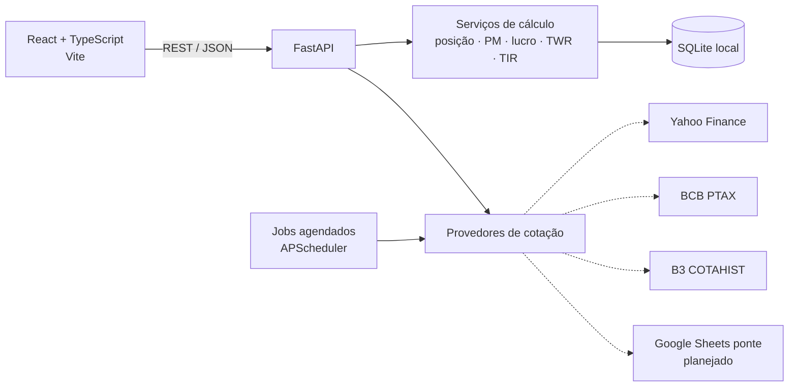

# ControleInv

> Controle de investimentos pessoal e multi-investidor — carteira, proventos, rentabilidade e imposto de renda, rodando localmente no seu computador.


O **ControleInv** substitui planilhas de controle de investimentos (Google Sheets/Excel) por uma aplicação web local. Ele consolida operações, proventos e cotações de vários investidores, calcula posição e preço médio conforme as regras da Receita Federal e evolui, por fases, para rentabilidade, alocação e apuração de IR.

---

## Sumário

- [Funcionalidades](#funcionalidades)
- [Arquitetura](#arquitetura)
- [Tecnologias](#tecnologias)
- [Requisitos](#requisitos)
- [Instalação e execução](#instalação-e-execução)
- [Importando a planilha](#importando-a-planilha)
- [Estrutura do projeto](#estrutura-do-projeto)
- [Regras de cálculo](#regras-de-cálculo)
- [API](#api)
- [Testes](#testes)
- [Roadmap](#roadmap)
- [Privacidade e segurança](#privacidade-e-segurança)
- [Aviso legal](#aviso-legal)

---

## Funcionalidades

### Disponíveis

| Área | O que faz |
|---|---|
| **Multi-investidor** | Cadastro de investidores (com CPF mascarado) e grupos (ex.: Família). Seletor global filtra todas as páginas: um investidor, um grupo ou todos consolidados. |
| **Resumo** | Patrimônio, lucro aberto/total, TIR, proventos e YoC dos últimos 12 meses, rentabilidade (TWR) no mês/ano/12 meses/desde o início comparada a IBOV, IFIX, CDI e IPCA, maiores altas e baixas do dia. |
| **Rentabilidade** | TWR acumulado × referências, evolução patrimonial (mercado × investido), resultado mensal e mapa de calor ano × mês, com seletor de período. |
| **Portfólio** | Posições abertas com quantidade, preço médio, cotação, valor investido/mercado, lucro do dia, lucro aberto, proventos e peso. Tabela ordenável, agrupamento por classe ou setor com subtotais, gráficos de exposição (classe, setor, ativo) e visão consolidada ou separada por investidor. |
| **Operações** | Lançamento, edição e exclusão pela interface; histórico com filtros por ticker e período; compra, venda, day trade e eventos societários. Câmbio preenchido automaticamente pela PTAX. |
| **Proventos** | Lançamento, edição e exclusão de dividendos, JCP, rendimentos, bonificações e amortizações, com IRRF e conversão cambial. Matriz mensal ano × mês e ativo × mês. |
| **Caixa** | Aportes, saques, créditos e débitos por investidor e corretora. |
| **Cotações** | Atualização automática no pregão (Yahoo Finance, B3 e EUA), fechamento oficial da B3 (COTAHIST) e câmbio pela PTAX do Banco Central. Histórico diário desde a primeira operação. Status das atualizações em Configurações. |
| **Importação** | Importa a planilha de controle existente (`.xlsx`) de forma idempotente e concilia o resultado com os valores calculados pela própria planilha. |

### Em desenvolvimento

Saldo de caixa por corretora, alocação e rebalanceamento, radar/watchlist, criptomoedas, apuração de IR e DARF, DIRPF e valuation. Veja o [plano de desenvolvimento](PLANO_DESENVOLVIMENTO.md).

---

## Arquitetura



- **Uma única porta:** o FastAPI serve a API em `/api` e a interface compilada em `/`.
- **Execução local:** escuta apenas em `127.0.0.1`; não há dependência de nuvem.
- **Cálculos puros:** regras de negócio isoladas em funções sem I/O, cobertas por testes.
- **Provedores plugáveis:** cada fonte de cotação implementa a mesma interface e é consultada em ordem de prioridade com fallback.

---

## Tecnologias

| Camada | Stack |
|---|---|
| Backend | Python 3.12+, FastAPI, SQLAlchemy 2, Alembic, Pydantic 2 |
| Dados | SQLite, pandas, openpyxl |
| Cotações | yfinance, httpx (BCB PTAX/SGS, B3 COTAHIST e índices), APScheduler |
| Frontend | React 18, TypeScript, Vite, React Router, TanStack Query |
| Testes | pytest |

---

## Requisitos

- **Windows** (scripts `.bat`; o código em si é multiplataforma)
- **Python 3.12+**
- **Node.js 20+** (somente para compilar a interface)
- Acesso à internet para cotações

---

## Instalação e execução

### Modo rápido

```bat
git clone https://github.com/Cristianosm91/Controle_Investimentos.git
cd Controle_Investimentos
iniciar.bat
```

Na primeira execução o `iniciar.bat`:

1. cria o ambiente virtual Python (`.venv`) e instala as dependências;
2. instala as dependências do frontend e compila a interface;
3. aplica as migrações do banco;
4. abre `http://127.0.0.1:8000` no navegador.

### Instalação manual

```powershell
# Backend
python -m venv .venv
.\.venv\Scripts\python.exe -m pip install -r backend\requirements.txt
cd backend
..\.venv\Scripts\python.exe -m alembic upgrade head

# Frontend
cd ..\frontend
npm install
npm run build

# Executar
cd ..\backend
..\.venv\Scripts\python.exe -m uvicorn app.main:app --host 127.0.0.1 --port 8000
```

### Modo desenvolvimento

```bat
dev.bat
```

Sobe a API com *reload* em `:8000` e o Vite com *hot reload* em `http://127.0.0.1:5173` (proxy de `/api` para o backend).

### Configuração

Copie `.env.example` para `.env` se quiser alterar o padrão:

| Variável | Padrão | Descrição |
|---|---|---|
| `CONTROLEINV_DB_PATH` | `%LOCALAPPDATA%\ControleInv\controleinv.db` | Caminho do banco SQLite |
| `CONTROLEINV_JOBS_ATIVOS` | `true` | Liga as atualizações automáticas em segundo plano |
| `CONTROLEINV_COTACOES_INTERVALO_MIN` | `15` | Intervalo das cotações no pregão (seg–sex, 10h–18h) |
| `CONTROLEINV_COTAHIST_HORA` | `21` | Hora da busca do fechamento oficial da B3 (repete às 8h) |
| `CONTROLEINV_PTAX_DIAS_UTEIS_ANTES` | `0` | Defasagem da PTAX sugerida nos lançamentos (0 = data do fato gerador) |

> O banco fica propositalmente fora de pastas sincronizadas (OneDrive, Dropbox), pois a sincronização de um SQLite aberto pode corrompê-lo.

> Em redes corporativas que bloqueiam o `registry.npmjs.org`, configure o registry interno no seu usuário (`npm config set registry <url> --location=user`) — não no projeto.

---

## Importando a planilha

O importador lê a planilha de controle (`.xlsx` exportado do Google Sheets, layout com as abas `op.normal`, `op.daytrade`, `proventos`, `caixa`, `ativos.`, `index.` e `dados.`):

```powershell
cd backend

# Simulação: importa, concilia e desfaz
..\.venv\Scripts\python.exe -m scripts.importar_planilha "C:\caminho\planilha.xlsx" --investidor "Nome" --simular

# Gravação definitiva
..\.venv\Scripts\python.exe -m scripts.importar_planilha "C:\caminho\planilha.xlsx" --investidor "Nome"
```

- **Idempotente:** cada linha recebe um hash; reimportar não duplica lançamentos.
- **Conciliação:** ao final, compara quantidade e preço médio de cada ativo com a aba `dados.` e lista divergências.
- **Multi-investidor:** rode uma vez por planilha/investidor usando `--investidor`.

### Histórico de cotações da B3

Depois de importar, carregue o histórico oficial (um arquivo COTAHIST por ano, desde a primeira operação) em **Configurações → Atualizações → Carregar histórico** ou pela linha de comando:

```powershell
cd backend
..\.venv\Scripts\python.exe -m scripts.carregar_cotahist              # desde a 1ª operação
..\.venv\Scripts\python.exe -m scripts.carregar_cotahist --desde 2024
..\.venv\Scripts\python.exe -m scripts.carregar_cotahist --diario     # só dias pendentes
```

Depois disso, o job diário mantém o histórico em dia (e recupera dias perdidos ao iniciar o app).

### Índices, PTAX e ativos do exterior

Para a rentabilidade (TWR × referências e valor de mercado mês a mês), carregue também **Configurações → Atualizações → Histórico de índices, PTAX e ativos do exterior**. Ele busca CDI, SELIC, IPCA e IGP-M no SGS do Banco Central, IBOV e IFIX na B3, a PTAX diária e o histórico do Yahoo para ativos dos EUA (desfazendo o ajuste de desdobramentos, pois as quantidades no app são as históricas). Depois, a tarefa diária mantém os meses recentes atualizados.

### Conciliação da rentabilidade

```powershell
cd backend
..\.venv\Scripts\python.exe -m scripts.conciliar_rentabilidade "C:\caminho\planilha.xlsx" --investidor "Nome" [--detalhar]
```

Compara mês a mês investido, mercado, proventos, lucro de trades e TWR com a aba `dashboard.` da planilha.

---

## Estrutura do projeto

```
.
├── backend/
│   ├── app/
│   │   ├── api/            # Rotas REST (cadastros, ativos, lançamentos, carteira, atualizações)
│   │   ├── providers/      # Provedores de cotação (Yahoo, BCB PTAX)
│   │   ├── services/       # Regras de negócio (posição, carteira, cotações, COTAHIST, rentabilidade, jobs)
│   │   ├── config.py       # Configurações via variáveis de ambiente
│   │   ├── db.py           # Engine e sessão SQLAlchemy
│   │   ├── dominio.py      # Vocabulário de eventos e moedas
│   │   ├── models.py       # Modelo de dados
│   │   ├── schemas.py      # Contratos de entrada/saída (Pydantic)
│   │   └── main.py         # Aplicação FastAPI
│   ├── alembic/            # Migrações do banco
│   ├── scripts/            # Importador da planilha e carga COTAHIST
│   └── tests/              # Testes automatizados
├── frontend/
│   └── src/
│       ├── components/     # Layout, seletor, listas, formulários, exposição
│       └── pages/          # Resumo, Portfólio, Rentabilidade, Operações, Proventos, Caixa, Configurações
├── iniciar.bat             # Execução local
├── dev.bat                 # Modo desenvolvimento
└── PLANO_DESENVOLVIMENTO.md
```

---

## Regras de cálculo

Custo, preço médio e lucro são apurados **em BRL**, convertendo cada movimento pelo câmbio (PTAX) da data, como exige a apuração de IR. Nos lançamentos em moeda estrangeira, o câmbio sugerido é a **PTAX de fechamento, para venda, da data do fato gerador** (Lei 14.754/2023, art. 15); sem boletim na data (fim de semana/feriado), usa-se o último dia útil anterior. O valor pode ser ajustado manualmente.

| Evento | Efeito na posição |
|---|---|
| Compra | Soma quantidade; custo += quantidade × preço + taxas |
| Venda | Reduz quantidade pelo PM; lucro = valor líquido − PM × quantidade |
| Bonificação | Entra pela quantidade e custo atribuído |
| Desdobramento / Grupamento | Altera só a quantidade; custo total mantido |
| Transferência (troca de ticker, incorporação) | Sai sem lucro do ticker antigo; entra pelo custo no novo |
| Amortização / Cisão | Reduz o custo sem alterar a quantidade |
| Venda de direito de subscrição | Lucro integral, sem afetar a posição |
| Day trade | Não altera a posição; lucro apurado separadamente |

Posições são calculadas **por investidor e ativo**; a visão consolidada soma quantidades e custos e recalcula o PM ponderado.

---

## API

Com a aplicação rodando, a documentação interativa (OpenAPI/Swagger) fica em:

- `http://127.0.0.1:8000/docs`

Principais recursos:

| Método | Rota | Descrição |
|---|---|---|
| `GET` | `/api/posicoes?investidores=1,2&agrupar=ativo` | Carteira consolidada ou por investidor |
| `POST` | `/api/cotacoes/atualizar` | Atualiza cotações e câmbio agora |
| `GET/POST/PUT/DELETE` | `/api/operacoes` | Operações (paginadas e filtráveis) |
| `GET/POST/PUT/DELETE` | `/api/proventos` | Proventos |
| `GET/POST/PUT/DELETE` | `/api/caixa` | Movimentações de caixa (entrada > 0, saída < 0) |
| `GET` | `/api/cambio/ptax?moeda=USD&data=2026-10-02` | PTAX oficial (compra/venda) da data |
| `GET` / `POST` | `/api/atualizacoes` · `/api/atualizacoes/{tarefa}` | Status e disparo das atualizações em segundo plano |
| `GET` | `/api/rentabilidade/mensal?inicio=&fim=` | Série mensal: investido, mercado, fluxo, lucro, TWR e referências |
| `GET` | `/api/rentabilidade/resumo` | Patrimônio, TIR, proventos 12m, YoC e TWR por janela |
| `GET` | `/api/proventos/matriz?ano=` | Proventos líquidos ano × mês (ou ativo × mês de um ano) |
| `GET/POST/PUT/DELETE` | `/api/investidores` | Investidores |
| `GET/POST/PUT/DELETE` | `/api/ativos` | Cadastro de ativos |

---

## Testes

```powershell
cd backend
..\.venv\Scripts\python.exe -m pytest -q
```

Os testes cobrem preço médio, venda, eventos societários, câmbio, day trade e consolidação entre investidores (com casos derivados de valores reais da planilha), além da leitura do COTAHIST, da escolha da PTAX, dos índices, do TWR (linhas reais da aba `dashboard.`), do XIRR e das APIs de lançamentos, caixa e rentabilidade (banco em memória).

---

## Roadmap

| Fase | Entrega | Status |
|---|---|---|
| 0 | Fundação: banco, API, importador, layout, cotações | ✅ Concluída |
| 1 | MVP de carteira: lançamentos pela interface, PTAX oficial, histórico B3 | ✅ Concluída (planilha-ponte Google Sheets adiada) |
| 2 | Rentabilidade (TWR, TIR) e página de resumo | ✅ Concluída |
| 3 | Configurações, alocação e rebalanceamento, caixa | ⏳ |
| 4 | Imposto de renda: apuração mensal, DARF, DIRPF | ⏳ |
| 5 | Radar, criptomoedas, status do ativo, valuation | ⏳ |
| 6 | Importação de extratos da B3, exportações e backup | ⏳ |

Detalhes em [PLANO_DESENVOLVIMENTO.md](PLANO_DESENVOLVIMENTO.md).

---

## Privacidade e segurança

- Todos os dados ficam **no seu computador**; nada é enviado a servidores próprios.
- As únicas chamadas externas são consultas públicas de cotação (tickers e moedas).
- A API escuta apenas em `127.0.0.1`.
- CPF é exibido sempre mascarado na interface.
- Planilhas, banco de dados e arquivos `.env` estão no `.gitignore`.

---

## Aviso legal

Este projeto é uma ferramenta pessoal de organização financeira e **não constitui recomendação de investimento**. Os cálculos de imposto de renda seguem as regras públicas da Receita Federal, mas devem ser conferidos com um contador antes de qualquer recolhimento. Cotações de terceiros podem apresentar atraso ou imprecisão.

---

Desenvolvido por **Cristiano Mota** · [@Cristianosm91](https://github.com/Cristianosm91)
