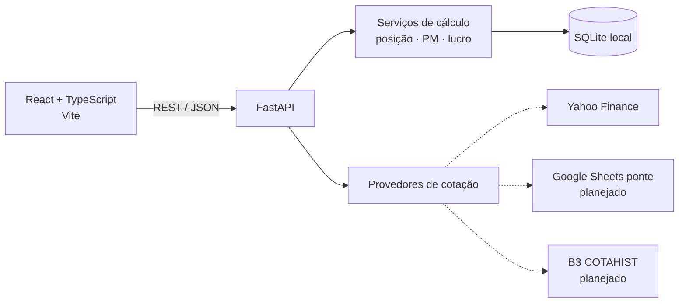

# ControleInv

> Controle de investimentos pessoal e multi-investidor — carteira, proventos, rentabilidade e imposto de renda, rodando localmente no seu computador.


O **ControleInv** substitui planilhas de controle de investimentos (Google Sheets/Excel) por uma aplicação web local. Ele consolida operações, proventos e cotações de vários investidores, calcula posição e preço médio conforme as regras da Receita Federal e evolui, por fases, para rentabilidade, alocação e apuração de IR.

---

## Sumário

- [Funcionalidades](#funcionalidades)
- [Arquitetura](#arquitetura)
- [Tecnologias](#tecnologias)
- [Requisitos](#requisitos)
- [Instalação e execução](#instalação-e-execução)
- [Importando a planilha](#importando-a-planilha)
- [Estrutura do projeto](#estrutura-do-projeto)
- [Regras de cálculo](#regras-de-cálculo)
- [API](#api)
- [Testes](#testes)
- [Roadmap](#roadmap)
- [Privacidade e segurança](#privacidade-e-segurança)
- [Aviso legal](#aviso-legal)

---

## Funcionalidades

### Disponíveis

| Área | O que faz |
|---|---|
| **Multi-investidor** | Cadastro de investidores (com CPF mascarado) e grupos (ex.: Família). Seletor global filtra todas as páginas: um investidor, um grupo ou todos consolidados. |
| **Portfólio** | Posições abertas com quantidade, preço médio, cotação, valor investido/mercado, lucro do dia, lucro aberto, proventos e peso. Tabela ordenável e visão consolidada ou separada por investidor. |
| **Operações** | Histórico completo com filtros por ticker e período; compra, venda, day trade e eventos societários. |
| **Proventos** | Dividendos, JCP, rendimentos, bonificações e amortizações, com IRRF e conversão cambial. |
| **Cotações** | Atualização sob demanda via Yahoo Finance (B3 e EUA) e câmbio USD/EUR → BRL. |
| **Importação** | Importa a planilha de controle existente (`.xlsx`) de forma idempotente e concilia o resultado com os valores calculados pela própria planilha. |

### Em desenvolvimento

Resumo, rentabilidade (TWR/TIR × IBOV, IFIX, CDI, IPCA), caixa, alocação e rebalanceamento, radar/watchlist, criptomoedas, apuração de IR e DARF, DIRPF e valuation. Veja o [plano de desenvolvimento](PLANO_DESENVOLVIMENTO.md).

---

## Arquitetura



- **Uma única porta:** o FastAPI serve a API em `/api` e a interface compilada em `/`.
- **Execução local:** escuta apenas em `127.0.0.1`; não há dependência de nuvem.
- **Cálculos puros:** regras de negócio isoladas em funções sem I/O, cobertas por testes.
- **Provedores plugáveis:** cada fonte de cotação implementa a mesma interface e é consultada em ordem de prioridade com fallback.

---

## Tecnologias

| Camada | Stack |
|---|---|
| Backend | Python 3.12+, FastAPI, SQLAlchemy 2, Alembic, Pydantic 2 |
| Dados | SQLite, pandas, openpyxl |
| Cotações | yfinance |
| Frontend | React 18, TypeScript, Vite, React Router, TanStack Query |
| Testes | pytest |

---

## Requisitos

- **Windows** (scripts `.bat`; o código em si é multiplataforma)
- **Python 3.12+**
- **Node.js 20+** (somente para compilar a interface)
- Acesso à internet para cotações

---

## Instalação e execução

### Modo rápido

```bat
git clone https://github.com/Cristianosm91/Controle_Investimentos.git
cd Controle_Investimentos
iniciar.bat
```

Na primeira execução o `iniciar.bat`:

1. cria o ambiente virtual Python (`.venv`) e instala as dependências;
2. instala as dependências do frontend e compila a interface;
3. aplica as migrações do banco;
4. abre `http://127.0.0.1:8000` no navegador.

### Instalação manual

```powershell
# Backend
python -m venv .venv
.\.venv\Scripts\python.exe -m pip install -r backend\requirements.txt
cd backend
..\.venv\Scripts\python.exe -m alembic upgrade head

# Frontend
cd ..\frontend
npm install
npm run build

# Executar
cd ..\backend
..\.venv\Scripts\python.exe -m uvicorn app.main:app --host 127.0.0.1 --port 8000
```

### Modo desenvolvimento

```bat
dev.bat
```

Sobe a API com *reload* em `:8000` e o Vite com *hot reload* em `http://127.0.0.1:5173` (proxy de `/api` para o backend).

### Configuração

Copie `.env.example` para `.env` se quiser alterar o padrão:

| Variável | Padrão | Descrição |
|---|---|---|
| `CONTROLEINV_DB_PATH` | `%LOCALAPPDATA%\ControleInv\controleinv.db` | Caminho do banco SQLite |

> O banco fica propositalmente fora de pastas sincronizadas (OneDrive, Dropbox), pois a sincronização de um SQLite aberto pode corrompê-lo.

> Em redes corporativas que bloqueiam o `registry.npmjs.org`, configure o registry interno no seu usuário (`npm config set registry <url> --location=user`) — não no projeto.

---

## Importando a planilha

O importador lê a planilha de controle (`.xlsx` exportado do Google Sheets, layout com as abas `op.normal`, `op.daytrade`, `proventos`, `caixa`, `ativos.`, `index.` e `dados.`):

```powershell
cd backend

# Simulação: importa, concilia e desfaz
..\.venv\Scripts\python.exe -m scripts.importar_planilha "C:\caminho\planilha.xlsx" --investidor "Nome" --simular

# Gravação definitiva
..\.venv\Scripts\python.exe -m scripts.importar_planilha "C:\caminho\planilha.xlsx" --investidor "Nome"
```

- **Idempotente:** cada linha recebe um hash; reimportar não duplica lançamentos.
- **Conciliação:** ao final, compara quantidade e preço médio de cada ativo com a aba `dados.` e lista divergências.
- **Multi-investidor:** rode uma vez por planilha/investidor usando `--investidor`.

---

## Estrutura do projeto

```
.
├── backend/
│   ├── app/
│   │   ├── api/            # Rotas REST (cadastros, ativos, lançamentos, carteira)
│   │   ├── providers/      # Provedores de cotação (Yahoo, ...)
│   │   ├── services/       # Regras de negócio (posição, carteira, cotações)
│   │   ├── config.py       # Configurações via variáveis de ambiente
│   │   ├── db.py           # Engine e sessão SQLAlchemy
│   │   ├── dominio.py      # Vocabulário de eventos e moedas
│   │   ├── models.py       # Modelo de dados
│   │   ├── schemas.py      # Contratos de entrada/saída (Pydantic)
│   │   └── main.py         # Aplicação FastAPI
│   ├── alembic/            # Migrações do banco
│   ├── scripts/            # Importador da planilha
│   └── tests/              # Testes automatizados
├── frontend/
│   └── src/
│       ├── components/     # Layout, seletor de investidor, listas
│       └── pages/          # Portfólio, Operações, Proventos, Configurações
├── iniciar.bat             # Execução local
├── dev.bat                 # Modo desenvolvimento
└── PLANO_DESENVOLVIMENTO.md
```

---

## Regras de cálculo

Custo, preço médio e lucro são apurados **em BRL**, convertendo cada movimento pelo câmbio (PTAX) da data, como exige a apuração de IR.

| Evento | Efeito na posição |
|---|---|
| Compra | Soma quantidade; custo += quantidade × preço + taxas |
| Venda | Reduz quantidade pelo PM; lucro = valor líquido − PM × quantidade |
| Bonificação | Entra pela quantidade e custo atribuído |
| Desdobramento / Grupamento | Altera só a quantidade; custo total mantido |
| Transferência (troca de ticker, incorporação) | Sai sem lucro do ticker antigo; entra pelo custo no novo |
| Amortização / Cisão | Reduz o custo sem alterar a quantidade |
| Venda de direito de subscrição | Lucro integral, sem afetar a posição |
| Day trade | Não altera a posição; lucro apurado separadamente |

Posições são calculadas **por investidor e ativo**; a visão consolidada soma quantidades e custos e recalcula o PM ponderado.

---

## API

Com a aplicação rodando, a documentação interativa (OpenAPI/Swagger) fica em:

- `http://127.0.0.1:8000/docs`

Principais recursos:

| Método | Rota | Descrição |
|---|---|---|
| `GET` | `/api/posicoes?investidores=1,2&agrupar=ativo` | Carteira consolidada ou por investidor |
| `POST` | `/api/cotacoes/atualizar` | Atualiza cotações e câmbio |
| `GET/POST/PUT/DELETE` | `/api/operacoes` | Operações (paginadas e filtráveis) |
| `GET/POST/DELETE` | `/api/proventos` | Proventos |
| `GET/POST/PUT/DELETE` | `/api/investidores` | Investidores |
| `GET/POST/PUT/DELETE` | `/api/ativos` | Cadastro de ativos |

---

## Testes

```powershell
cd backend
..\.venv\Scripts\python.exe -m pytest -q
```

Os testes cobrem preço médio, venda, eventos societários, câmbio, day trade e consolidação entre investidores, com casos derivados de valores reais da planilha.

---

## Roadmap

| Fase | Entrega | Status |
|---|---|---|
| 0 | Fundação: banco, API, importador, layout, cotações | ✅ Concluída |
| 1 | MVP de carteira: lançamentos pela interface, PTAX oficial, histórico B3 | 🚧 Em andamento |
| 2 | Rentabilidade (TWR, TIR) e página de resumo | ⏳ |
| 3 | Configurações, alocação e rebalanceamento, caixa | ⏳ |
| 4 | Imposto de renda: apuração mensal, DARF, DIRPF | ⏳ |
| 5 | Radar, criptomoedas, status do ativo, valuation | ⏳ |
| 6 | Importação de extratos da B3, exportações e backup | ⏳ |

Detalhes em [PLANO_DESENVOLVIMENTO.md](PLANO_DESENVOLVIMENTO.md).

---

## Privacidade e segurança

- Todos os dados ficam **no seu computador**; nada é enviado a servidores próprios.
- As únicas chamadas externas são consultas públicas de cotação (tickers e moedas).
- A API escuta apenas em `127.0.0.1`.
- CPF é exibido sempre mascarado na interface.
- Planilhas, banco de dados e arquivos `.env` estão no `.gitignore`.

---

## Aviso legal

Este projeto é uma ferramenta pessoal de organização financeira e **não constitui recomendação de investimento**. Os cálculos de imposto de renda seguem as regras públicas da Receita Federal, mas devem ser conferidos com um contador antes de qualquer recolhimento. Cotações de terceiros podem apresentar atraso ou imprecisão.

---

Desenvolvido por **Cristiano Mota** · [@Cristianosm91](https://github.com/Cristianosm91)
